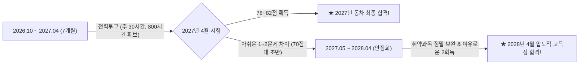
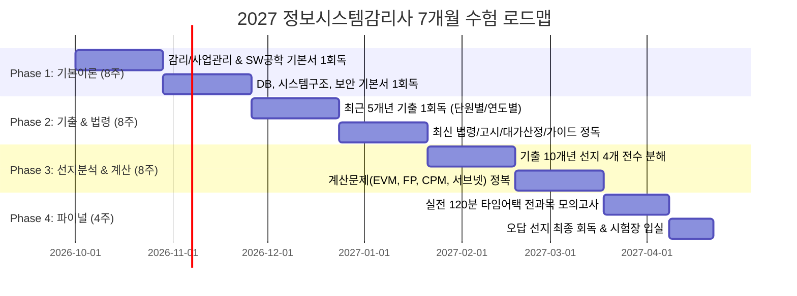

---

## 🕒 사용자 맞춤형 일과 시간표 및 디바이스 활용 전략 (주 30~35시간 확보)

하루 출퇴근 시간 **3시간 20분(200분)**을 버려지는 시간이 아닌 **'황금의 분산 반복 학습 시간'**으로 전환하면, 퇴근 후 1~2시간과 주말을 합쳐 **주당 30~35시간의 학습량**을 확보할 수 있습니다. 이는 전업 수험생에 버금가는 시간으로, 7개월간 누적 **800시간 이상**을 달성하여 2027년 동차 합격을 충분히 노릴 수 있습니다.

| 시간대 | 소요 시간 | 이동 환경 | 사용 디바이스 | 추천 학습 활동 (Activity) |
| :--- | :---: | :--- | :--- | :--- |
| **출근길 (지하철 3회 환승)** | **1시간 40분** | 걷기/계단 + 혼잡 지하철 | **스마트폰** + 무선이어폰 | • **환승/보행 중**: 암기용 오디오 강의 청취 (법령, 감리기준, 용어 요약) • **지하철 탑승 중**: 스마트폰 플래시카드(Anki/노션)로 단답형 키워드 암기 및 1문항 퀴즈 풀이 |
| **퇴근길 (버스 2회 환승)** | **1시간 40분** | 차체 흔들림, 환승 대기 | **스마트폰/아이패드** + 이어폰 | • 버스 흔들림으로 인한 활자 독서(멀미) 지양 • **1.3~1.5배속 인강 '귀팅'(Audio-first)**으로 당일 복습 또는 개념 예습 • 자리에 앉았을 때 아이패드로 큼직한 도표/마인드맵 스크리닝 |
| **퇴근 후 (자택 책상)** | **1.5 ~ 2시간** (21:30~23:30) | 조용한 집중 환경 | **PC / 아이패드** + 필기도구 | • **고도의 집중이 필요한 학습 수행** • 계산문제(EVM, FP, CPM, 서브넷) 직접 손으로 풀기 • 틀린 문제 오답 정리 및 선지 분해 노트 작성 |
| **일요일 (종일 몰입)** | **8 ~ 10시간** | 독서실 / 서재 | **교재 + 태블릿** | • **주간 메인 진도 완주** (인강 5~8강 정주행) • 기출 1개년 전 과목(125문항) 모의고사 실전 풀이 및 분석 |
| **토요일 (상황별)** | **2 ~ 4시간 (유동적)** | 유동적 시간 | 스마트폰 / 교재 | • 주중 밀린 진도 보충 또는 가벼운 핵심 요약 회독 |

---

## 🎯 2개년 투트랙(Two-Track) 합격 전략 (2027 vs 2028)

1. **Track 1: 2027년 4월 동차 합격 목표 (전력 질주)**
   - 출퇴근 3시간 20분을 완벽히 흡수하여 7개월 동안 전 과목 3회독 + 기출 5개년을 완주합니다.
   - 16년 차 실무 경력자의 내공(SW공학, DB, 시스템구조)을 살려 감리/사업관리와 보안 과목만 집중 공략하면 7개월 단기 합격 가능성은 충분합니다.
2. **Track 2: 2028년 4월 백업 시나리오 (리스크 제로화)**
   - 2027년 시험을 '최고의 실전 모의고사'로 삼습니다.
   - 만약 근소한 점수 차로 불합격하더라도 이미 전 과목 80% 이상의 실력이 완성되어 있으므로, 2027년 하반기부터는 주 10~15시간 페이스 유지 및 최신 개정 법령/기출만 보완하여 2028년에 85점 이상의 압도적 고득점으로 수석급 합격을 달성합니다.

---

## 📌 Phase 1: 기본 개념 정립 및 전 과목 1회독 (1~8주차, 10월~11월)
> **목표**: 각 과목의 뼈대를 세우고 생소한 용어와 체계를 뇌에 각인시키는 단계. 이해가 100% 되지 않아도 완주(1회독)가 최우선.

| 주차 | 대상 과목 | 주요 학습 내용 | 주간 목표 산출물 |
| :---: | :--- | :--- | :--- |
| **1주차** | 감리 및 사업관리 | 감리 정의, 3단계 감리체계, 전자정부법상 감리기준, PMBOK 10대 영역 개요 | 감리 절차도 요약 정리 |
| **2주차** | 감리 및 사업관리 | 프로젝트 일정/원가/품질 관리, 위험관리, IT 거버넌스, CMMI, ITIL | 사업관리 용어집 작성 |
| **3주차** | 소프트웨어공학 | 개발 생명주기(Agile, Scrum, XP), 요구사항 도출/분석 기법, UML | SDLC 비교표 작성 |
| **4주차** | 소프트웨어공학 | 아키텍처 스타일(MSA 등), 디자인패턴(GoF), 테스트 기법, 리팩토링, 메트릭 | 디자인패턴/테스트 요약 |
| **5주차** | 데이터베이스 | 데이터 모델링(개념/논리/물리), 정규화(1~5NF, BCNF)와 반정규화, 관계대수 | 정규화/이상현상 정리 |
| **6주차** | 데이터베이스 | 트랜잭션과 ACID, 동시성 제어(2PL, MVCC), 회복 기법, 인덱스 구조, SQL 고급 | 트랜잭션 격리수준 표 |
| **7주차** | 시스템구조 | CPU 파이프라인, 캐시 메모리 및 일관성, 가상메모리(페이징), 프로세스/스레드 | 컴퓨터구조 핵심 매핑 |
| **8주차** | 시스템구조 & 보안 | OSI 7계층, TCP/IP, 암호학(대칭/비대칭/해시), 접근통제, 시큐어코딩 기초 | 보안/네트워크 기본기 점검 |

---

## 📌 Phase 2: 기출 1회독 & 법령·국가 가이드라인 정복 (9~16주차, 12월~1월)
> **목표**: 실제 출제 경향을 체감하고, 감리사 시험의 30~40%를 좌우하는 법제도/가이드를 확실히 점수화하는 단계.

| 주차 | 주요 영역 | 세부 과제 | 학습 방법 |
| :---: | :--- | :--- | :--- |
| **9주차** | 감리/SW공학 기출 | 최근 5개년(2022~2026) 감리·사업관리 & SW공학 기출 1회독 | 정답 해설 위주 속독 |
| **10주차** | DB/시스템/보안 기출 | 최근 5개년(2022~2026) DB, 시스템구조, 보안 기출 1회독 | 틀린 문제 및 모르는 개념 체크 |
| **11주차** | 감리 기준 고시 | 행정안전부 '정보시스템 감리기준' 고시 전문 정독 및 해설서 분석 | 점검항목, 감리인원수 산정 등 |
| **12주차** | SW사업 대가산정 | 소프트웨어사업 대가산정 가이드(기능점수 FP 단가, 보정계수 계산) | FP 간이법/정규법 계산 실습 |
| **13주차** | 공공 SW 법령 | 전자정부법, 소프트웨어진흥법(제재, 하도급제한, 요구사항상세화) | 핵심 조문 암기노트 작성 |
| **14주차** | 보안 법령 & 인증 | 개인정보보호법(개정안 반영), 가명정보 처리 가이드, ISMS-P 인증기준 | 개인정보 안전성 확보조치 정리 |
| **15주차** | 신기술 가이드라인 | 국가 제로트러스트 가이드라인 v2.0, 클라우드 네이티브 아키텍처 지침 | 신기술 용어 및 원칙 정리 |
| **16주차** | 1회독 총점검 | 기출 1회독 오답 누적 노트 작성 및 과목별 취약 도메인 1차 도출 | 취약 과목 우선순위 지정 |

---

## 📌 Phase 3: 선지 정밀 분해(4지선다 전수분석) & 계산문제 마스터 (17~24주차, 2월~3월)
> **목표**: '왜 정답인가'뿐 아니라 '나머지 3개 선지가 왜 오답인가'를 밝혀내는 분석으로 득점력을 80점 이상으로 끌어올리는 단계.

| 주차 | 테마 | 중점 실행 과제 |
| :---: | :--- | :--- |
| **17주차** | 감리/사업관리 선지분석 | 10개년 기출 선지 분석 (오답 선지를 올바른 문장으로 고치기 훈련) |
| **18주차** | SW공학 선지분석 | 디자인패턴, 테스트 커버리지 조건, 아키텍처 스타일 관련 까다로운 선지 정리 |
| **19주차** | DB 선지분석 | 복합 SQL 실행계획 해석, 트랜잭션 동시성 이상현상 시나리오 문제 분석 |
| **20주차** | 시스템구조 선지분석 | 파이프라인 지연 클록 계산, 캐시 히트율, 페이지 교체 알고리즘 선지 분해 |
| **21주차** | 보안 선지분석 | 암호 블록 모드(CBC/CTR 등) 차이점, 취약점 공격 벡터(SSRF, CSRF 등) 정밀 분석 |
| **22주차** | **계산문제 집중 1** | **사업관리 계산**: EVM (PV, EV, AC, CV, SV, CPI, SPI, EAC, ETC), CPM 임계경로, PERT 기댓값 |
| **23주차** | **계산문제 집중 2** | **SW공학 & IT 계산**: FP 개발비 산정, 서브넷/슈퍼넷 마스크, 가용도(MTBF, MTTR), Amdahl 법칙 |
| **24주차** | **나만의 단권화 완성** | 5개 과목 오답 선지 + 암기 요약본을 A4 50페이지 이내로 압축 단권화 |

---

## 📌 Phase 4: 실전 120분 타임어택 & 최종 파이널 (25~28주차, 4월)
> **목표**: 125문항을 120분 안에 풀고 마킹까지 완수하는 실전 감각 및 멘탈 극대화.

- **25주차 (실전 모의고사 1회차 & 2회차)**
  - 실제 시험 시간(토요일 오전 10:00 ~ 12:00)에 맞춰 120분 스톱워치 측정 후 125문항 풀이
  - OMR 카드 마킹 연습 병행 (문항당 50초 풀이 + 10초 마킹 원칙 체화)
- **26주차 (실전 모의고사 3회차 & 4회차)**
  - 모의고사 오답 분석 및 모르는 계산 문제 과감히 넘기는 '스킵(Skip) 전략' 훈련
  - 점수대 분석 및 과락(40점 미만) 방어 영역 재점검
- **27주차 (시험 1주 전 파이널)**
  - 최근 3개년 최신 기출문제 선지만 빠르게 스크리닝 (오답 선지 위주)
  - 최신 법령 개정사항 및 2026~2027 최신 신기술 키워드(생성형 AI 안전성, 클라우드 보안 등) 최종 암기
- **28주차 (시험 주간 및 D-Day)**
  - 수험표, 신분증, 컴퓨터용 싸인펜, 수정테이프, 아날로그 시계 사전 패킹
  - 시험 전날 컨디션 관리(충분한 수면) 후 시험장 입실 및 합격!
