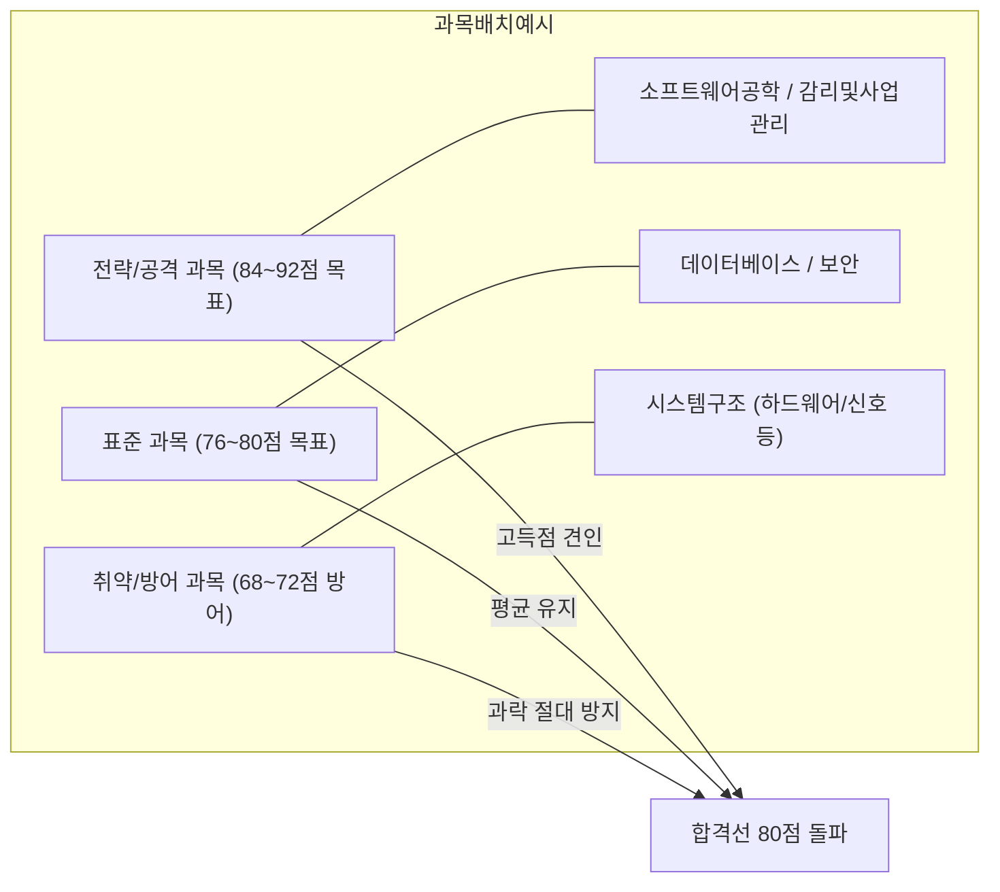

# 정보시스템감리사 시험제도 및 합격 전략

정보시스템감리사는 국내 IT 자격증 중 기술사와 더불어 최고 수준의 권위와 난이도를 자랑하는 전문 자격입니다. 기술사가 논술형 서술 시험이라면, 감리사는 **고도의 전문 지식과 법제도를 묻는 객관식의 기술사 시험**입니다.

---

## 1. 시험 제도 상세 개요

### ① 주관 및 기본 규정
- **주관 기관**: 과학기술정보통신부·행정안전부 주관 / **한국지능정보사회진흥원(NIA)** 시행
- **근거 법령**: 전자정부법 제57조(감리법인 등의 등록) 및 동법 시행령 제71~73조
- **선발 방식**: 통상 매년 약 **40명 내외** 최종 선발 (고득점순 선발, 절대평가 기준인 전 과목 60점 이상자 중 고득점자순 선발로 실질적 **상대평가**)
- **과락 기준**: 과목당 100점 만점 기준 **40점 미만(25문항 중 10문항 미만 득점) 시 총점과 무관하게 불합격**

### ② 시험 구성 및 배점

| 교시 | 시험 시간 | 과목명 | 문항수 | 비고 |
| :---: | :---: | :--- | :---: | :--- |
| **단일 교시** | **120분** (10:00 ~ 12:00) | 1. 감리 및 사업관리 2. 소프트웨어공학 3. 데이터베이스 4. 시스템구조 5. 보안 | 과목당 25문항 (**총 125문항**) | • 4지 선다형 객관식 • 문항당 0.8점 배점 (과목당 20점 환산 후 100점 만점) |

> [!WARNING]
> **타임어택의 본질: 1문항당 57.6초!**
> 120분 동안 125문항을 읽고, 계산하고, OMR 카드에 마킹까지 마쳐야 합니다. 실제로는 마킹 시간 10~15분을 제외하면 **문항당 순수 풀이 시간은 약 50초**에 불과합니다. 지문이 긴 시나리오형 문제나 복잡한 계산 문제는 2분 이상 소요되므로, 철저한 시간 배분 전략 없이는 20~30문항을 찍고 나오는 사태가 발생합니다.

---

## 2. 역대 합격 커트라인 동향 및 목표 점수 설정

감리사 시험의 커트라인은 매년 문제의 난이도에 따라 변동하지만 대체로 아래의 밴드를 형성합니다.

- **역대 커트라인 추이**: 통상 **74점 ~ 82점 사이** (125문항 중 약 93~102문항 정답 시 합격권)
- **최종 합격을 위한 안전 목표 점수**: **평균 80.0점 이상 (125문항 중 100문항 이상 정답)**

### 과목별 득점 전략 (공격 과목 vs 방어 과목 모델)

개인의 전문 분야(개발자, 인프라 엔지니어, DB 엔지니어, 보안 전문가 등)에 따라 편차가 있지만, 합격자들의 표준적인 포트폴리오 전략은 다음과 같습니다:

1. **감리 및 사업관리 (목표: 80~88점)**
   - 법령, 고시, 감리기준, SW사업 대가산정, PMBOK 프로세스는 **공부한 만큼 100% 정직하게 점수가 나오는 과목**입니다.
   - 여기서 80점대 중후반을 확보하지 못하면 전체 평균을 끌어올리기 어렵습니다.
2. **소프트웨어공학 (목표: 80~88점)**
   - 개발 및 프로젝트 경험이 있는 실무자에게 가장 친숙한 과목입니다.
   - 디자인패턴, 아키텍처, 테스트 기법, 리팩토링, 메트릭 등 정형화된 영역에서 실수를 최소화하여 고득점을 노려야 합니다.
3. **데이터베이스 (목표: 76~84점)**
   - 정규화, 관계대수, 트랜잭션 격리수준, SQL 윈도우 함수/계층형 쿼리 등 계산 및 쿼리 해석 문제가 까다롭습니다.
   - 기본 원리를 탄탄히 다지면 안정적인 80점 확보가 가능합니다.
4. **시스템구조 (목표: 68~76점 - 최대 복병 과목)**
   - 컴퓨터 구조(파이프라인 해저드, 캐시 매핑), OS 내부 동작, 네트워크 라우팅 프로토콜, 최신 하드웨어 기술 등 범위가 방대합니다.
   - 비전공자나 인프라 경험이 적은 수험생의 경우 과락 위험이 가장 높은 과목이므로, **기출 빈출 영역(파이프라인, 서브넷, 캐시, 스케줄링)을 완벽히 마스터하여 70점 이상으로 안전하게 방어**해야 합니다.
5. **보안 (목표: 76~84점)**
   - 암호학(계산 및 원리), 시스템/네트워크 보안, 시큐어 코딩, 법령(개인정보보호법, ISMS-P)에서 출제됩니다.
   - 최신 보안 트렌드(Zero Trust, 클라우드 보안)와 시큐어 코딩 지침을 정복하면 고득점 효자 과목이 될 수 있습니다.

---

## 3. 감리사 합격을 가르는 3대 핵심 성공 요인 (KSF)

### ① 선지 전수 분석 (4지선다 분해 학습)
- 감리사 시험은 기출문제가 토씨 하나 안 틀리고 그대로 재출제되는 비율은 낮지만, **과거 기출의 '오답 선지'가 다음 해 시험의 '정답 선지'로 변형 출제**되는 경향이 매우 뚜렷합니다.
- 기출을 풀 때 정답 번호만 맞히고 넘어가는 방식은 절대 금물입니다.
- **"1번 선지가 왜 틀렸는지(틀린 단어 교정)", "2번 선지의 배경 지식은 무엇인지"**를 철저히 파고드는 오답 선지 교정 훈련이 필수입니다.

### ② 계산문제 자동 반사화
- 시험장에서는 긴장감 때문에 계산 공식을 생각할 여유가 없습니다.
- EVM 공식(SV, CV, SPI, CPI, EAC, ETC), 기능점수(FP) 간이법/정규법 계산, CPM 임계경로 및 총여유(TF)/자유여유(FF) 계산, 서브넷 마스크 계산 등은 문제를 보자마자 손이 자동으로 계산식을 쓸 수 있도록 반복 숙달해야 합니다.

### ③ 법령 및 국가 가이드라인 최신 개정판 학습
- 시험 공고일 현재 시행 중인 최신 법령이 기준이 됩니다.
- 옛날 교재로 공부할 경우 개정된 개인정보보호법(예: 전송요구권, 이동권, 과징금 규정 등)이나 개정된 소프트웨어진흥법 조항에서 오답을 고르게 됩니다. 국가법령정보센터 및 공공기관 최신 가이드라인 원문을 확인하는 습관이 중요합니다.
