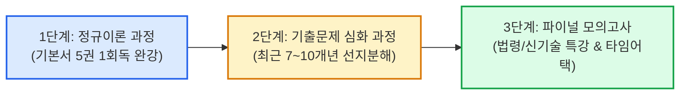

# 정보시스템감리사 추천 인강 및 교육기관 비교 분석

정보시스템감리사는 출제 범위가 방대하고 기술사 수준의 깊이를 요구하므로, 기사 시험처럼 시중 문제집만으로는 대비가 어렵습니다. 합격생 대다수가 전문 교육기관의 동영상 강의(인강)를 통해 뼈대를 잡은 후 기출 분석으로 넘어갑니다.

본 가이드는 수험생의 학습 전략에 맞춰 **정감완(정보시스템감리사 완전정복)**을 메인 수험 플랫폼으로 채택하고, 그에 맞춘 최적의 커리큘럼 및 학습 로드맵을 제시합니다.

---

## 1. 주요 감리사 전문 교육기관 비교

| 구분 | **정감완 (정보시스템감리사 완전정복)**  *(★ 수험생 추천·채택)* | **ITPE (아이티프로)** | **아이리포 (i-ripo / KPC 연계)** |
| :--- | :--- | :--- | :--- |
| **공식 웹사이트** | 🌐 [junggam.com](https://www.junggam.com) | 🌐 [itpe.co.kr](https://www.itpe.co.kr) | 🌐 [i-ripo.com](https://www.i-ripo.com) |
| **대표 특징** | **오직 정보시스템감리사 자격증 하나만 100% 집중 특화** | 기술사 기반 대형 IT 자격 종합 교육기관 | KPC(한국생산성본부) 연계 공공·표준 중심 |
| **대표 강사진** | 남태혁, 강혁, 황정연, 장덕호 감리사 | 강정배 기술사 외 전문 교수진 | 주말 오프라인/온라인 전담 교수진 |
| **수험생 선호도** | **순수 감리사 단독 준비생 선호도 1위 (최다 합격자 배출)** | 기술사/감리사 동시 병행 준비생 선호 | 공공기관 종사자 및 체계적 학원 커리큘럼 선호 |
| **교재 제공 방식** | **정규 인강 수강 시 자체 제작 기본서 5권 세트 택배 배송** *(시중 서점 미판매, 수강생 전용 전문 비매품)* | 자체 교재 수강생 별도 구매 또는 배송 | 자체 교재 별도 구매 |
| **강의 스타일** | • 감리사 기출 패턴 및 120문항 객관식 타임어택에 최적화 • 기출 4개 선지 오답 분석 및 최신 법령/대가산정 집중 | • 기술사급의 깊이 있는 원리와 폭넓은 IT 지식 • 방대한 수험생 네트워크 및 스터디 인프라 | • 공공 SW 사업 관리 및 정석적인 표준 중심 이론 |
| **선택 추천 사유** | **방대한 기술사 범위에 휩쓸리지 않고 감리사 시험에 꼭 나오는 핵심만 단기 집중 공략 가능** | 기술사 취득 후 감리사를 연속 취득하려는 경우 | 오프라인 주말반 현장 강의를 선호하는 경우 |

---

## 2. 정감완 (정감원) 마스터 커리큘럼 및 7개월 수강 로드맵

정감완을 주력 플랫폼으로 학습할 경우, 출퇴근 시간(왕복 3시간 20분)과 일요일 몰입 시간(8~10시간)을 활용하여 다음과 같이 3단계로 완주하는 것이 가장 효율적입니다.

### ① 1단계: 정규이론 과정 (10월 ~ 12월, 약 10주)
- **제공 교재**: 정규과정 신청 시 배송되는 **과목별 기본서 5권 세트** (감리·사업관리, SW공학, DB, 시스템구조, 보안).
- **학습 목표**: 5대 전 과목 핵심 이론 체계 수립 및 용어 친숙화.
- **활용법**:
  - **퇴근길 버스 (1시간 40분)**: 스마트폰으로 1.3~1.5배속 인강 청취 (차량 흔들림으로 독서가 어려우므로 청각·시각 강의 시청에 집중).
  - **일요일 (종일 몰입)**: 주중에 인강으로 들었던 범위의 기본서 교재를 정독하고, 단원별 연습문제를 직접 풀며 오답 정리.

### ② 2단계: 연도별/단원별 기출문제 풀이 과정 (1월 ~ 2월, 약 8주)
- **제공 교재**: 정감완 기출문제 해설집 (최근 7~10개년 기출 전 문항 수록).
- **학습 목표**: 기출 4개 선지(①~④)의 정답/오답 근거를 100% 분해하여 출제자의 함정 패턴 체득.
- **활용법**:
  - **선(先) 문제풀이 $\rightarrow$ 후(後) 발췌 수강**: 인강을 처음부터 끝까지 듣지 말고, **먼저 본인이 시간을 재고 기출문제를 푼 다음**, 틀린 문제나 헷갈렸던 선지가 포함된 문항만 해당 강의를 1.5배속으로 골라 듣습니다. (시간 60% 단축 효과)
  - **출근길 지하철 (1시간 40분)**: 전날 기출 풀이 중 틀렸던 문제의 오답 노트를 태블릿으로 복습.

### ③ 3단계: 실전 모의고사 및 파이널 족집게 특강 (3월 ~ 4월 시험 직전, 약 6주)
- **제공 자료**: 당해 연도 예상 출제 모의고사, 최신 개정 법령/고시 요약집, 최신 신기술 동향 특강.
- **학습 목표**: 120문항 120분 실전 타임어택 감각 완성 및 신기술/개정법령 5~10점 추가 확보.
- **활용법**:
  - 일요일마다 실제 시험 시간표(오전 09:30~11:50)에 맞춰 120분간 OMR 마킹까지 실전 모의고사를 치릅니다.
  - 최신 「정보시스템 감리기준」 고시 및 「SW사업 대가산정 가이드」 개정 특강을 반드시 수강하여 매년 바뀌는 수치와 규정을 숙지합니다.

---

## 3. 인강 수강 시 반드시 지켜야 할 3대 원칙

> [!CAUTION]
> ### ⚠️ 인강 시청의 함정에 빠지지 마라
> 인강을 화면으로 보기만 하는 것은 '남이 공부하는 것을 구경하는 것'에 불과합니다. 감리사 시험은 1문항당 50초 내에 스스로 지문을 읽고 정오를 판단하는 순발력이 핵심입니다.

1. **완강 집착 금지 & 배속 수강 (1.3~1.5배속)**:
   - 16년 차 실무 경험이 있는 소프트웨어/DB/보안 분야는 기본 개념 강의를 1.5~1.8배속으로 빠르게 넘기고, 실무와 거리가 먼 `시스템구조(하드웨어/파이프라인)` 및 `감리·사업관리(법령/대가산정/EVM)` 위주로 집중 복습합니다.
2. **반드시 '문제 풀이 $\rightarrow$ 강의 수강' 순서 준수**:
   - 기출 강의는 본인이 직접 고민하고 오답을 낸 상태에서 들어야 뇌에 각인됩니다. 풀지 않고 강의부터 보면 '다 아는 것 같다'는 착각에 빠집니다.
3. **정감완 Q&A 게시판 적극 활용**:
   - 혼자 고민해도 이해가 안 되는 복잡한 계산식이나 법령 해석은 정감완 수험생 질의응답 게시판에 질문하여 강사진의 피드백을 신속히 받습니다.
