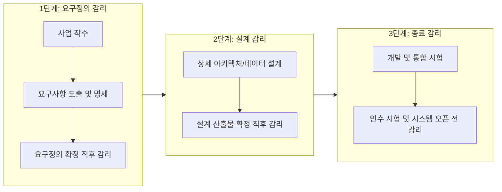
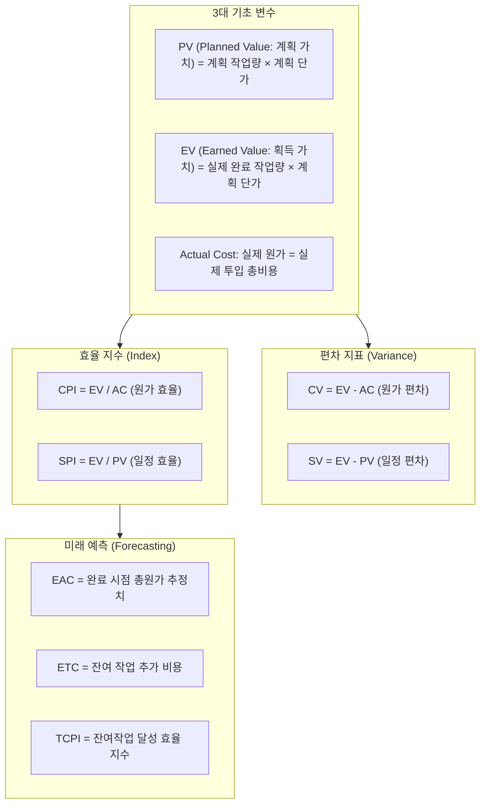

# 제1과목: 감리 및 사업관리 종합 마스터 가이드

본 가이드는 정보시스템감리사 제1과목(감리 및 사업관리)의 고득점(85점 이상)을 달성하기 위해, 법령·고시, 감리 실무 기준, PMBOK 6/7판 프로젝트 사업관리 체계, SW 개발 대가산정 및 IT 거버넌스를 상세하고 체계적으로 해설한 수험용 바이블입니다.

---

## 1. 정보시스템 감리 제도 및 법적 체계

### (1) 감리의 정의 및 3대 관점 (전자정부법 제57조)
*   **법적 정의**: 감리발주자 및 피감리인의 이해관계로부터 독립된 자(감리법인)가 정보시스템의 효율성을 향상시키고 안전성을 확보하기 위하여 제3자적 관점에서 정보시스템의 구축·운영에 관한 사항을 종합적으로 점검하고 개선이 필요한 사항을 권고하는 활동.
*   **감리의 3대 관점 (감리 기준의 지향점)**:
    1.  **효과성(Effectiveness)**: 정보시스템이 도입 목적 및 사용자의 업무 요구사항을 온전히 충족하는가?
    2.  **효율성(Efficiency)**: 사업 추진 과정에서 투입된 예산, 일정, 인력, 기술 자원이 낭비 없이 최적화되었는가?
    3.  **안전성(Safety / Security)**: 시스템의 정보보호, 개인정보보호, 연속성(재해복구), 신뢰성 및 무결성이 기술적·제도적으로 보장되는가?

### (2) 감리의 법적 의무 대상 (전자정부법 시행령 제71조)
공공기관의 장은 다음 각 호의 어느 하나에 해당하는 구축사업에 대하여 감리법인으로 하여금 감리를 하게 하여야 함:
1.  **사업비 10억원 이상인 정보시스템 구축사업** (원칙적 필수 의무 감리).
2.  사업비 1억원 이상 10억원 미만의 사업 중 다음에 해당하는 사업:
    *   국민의 권리·의무 또는 일상생활에 중대한 영향을 미치는 대민 서비스 시스템
    *   중앙행정기관 및 지자체 간, 또는 다수 행정기관 간의 공동 연계·활용 시스템
    *   개인정보를 대량(예: 5만명 이상)으로 처리하는 정보시스템
    *   행정업무 처리에 중대한 장애를 초래할 우려가 높은 시스템
3.  **감리 제외(면제) 대상**:
    *   단순 상용 하드웨어(HW) 및 기성 소프트웨어(패키지 SW)의 단순 구매·설치 사업
    *   순수 통신망 회선 구축 및 인프라 이전 사업
    *   단순 유지보수 및 운영 위탁 사업 (단, 발주기관의 장이 안전성 확보를 위해 필요하다고 인정하는 경우 임의 감리 가능)

### (3) 감리 단계 및 감리 시기 (3단계 감리 원칙)

| 감리 단계 | 실시 시기 | 핵심 점검 내용 및 필수 검토 산출물 |
| :--- | :--- | :--- |
| **요구정의 단계** | 요구사항 정의서 확정 직후 (전체 공정의 20~30% 시점) | • 제안요청서(RFP)와 요구사항정의서 간의 **추적성(Traceability)** 검증 • 요구사항의 구체성, 모호성 배제, 누락 여부 검증 • 과업 범위 확정 및 과업 변경 관리 절차 점검 |
| **설계 단계** | 상세 설계 완료 시점 (전체 공정의 40~50% 시점) | • 시스템/SW 아키텍처 설계 적합성 • 논리/물리 데이터베이스 모델링 및 정규화 적합성 • 인터페이스 연계 설계, 시큐어코딩 설계, 개인정보보호 설계 |
| **종료 단계** | 개발 완료 및 인수테스트 직전 (전체 공정의 80~90% 시점) | • 요구사항 최종 구현율(기능/비기능 전수 검증) • 통합시험/성능시험(부하, 스트레스)/보안약점 진단 결과서 검증 • 사용자 매뉴얼, 교육 계획, 운영 이관 및 비상계획(DR) 점검 |

> **2단계 감리 적용 기준**: 사업 기간이 6개월 미만의 단기 사업이거나 사업비 5억원 미만의 소규모 사업인 경우, 발주기관의 승인을 받아 '요구정의 감리'를 생략하고 **설계 단계와 종료 단계의 2단계 감리**로 축소 운영할 수 있음.

---

## 2. 감리 절차 및 감리보고서 작성 실무

### (1) 현장 감리 표준 8단계 프로세스
1.  **사전 준비 및 예비조사**:
    *   감리계약 체결 후, 현장감리 착수 1~2주 전 발주기관과 사업자로부터 기본 사업관리 문서(사업수행계획서, 요구사항정의서 등)를 인수받아 사전 검토.
    *   사업 특성을 반영한 **감리계획서(점검항목, 일정, 감리원 배치도)**를 작성하여 발주자와 사업자에게 공식 제출.
2.  **착수 회의 (Kick-off Meeting)**:
    *   현장감리 1일 차 오전 개최.
    *   발주기관 관리자, 사업자 PM 및 부문별 책임자(PL), 감리원 전원 참석.
    *   감리 일정, 점검 방법, 인터뷰 대상자, 테스트 실사 계획 상호 합의.
3.  **현장감리 수행 (문서 검토, 인터뷰, 시스템 실사)**:
    *   문서 검토: 산출물 간 정합성, 최신 버전 반영 여부 검토.
    *   담당자 인터뷰: 설계 의도 및 개발 표준 준수 여부 질의.
    *   실사 및 테스트: 소스코드 보안약점 진단 도구 검증, 실제 데이터베이스 연결 테스트, 기능 동작 실사.
4.  **감리수행결과 보고서 작성**:
    *   감리원 각자가 담당 분야의 발견사항(Finding)을 작성하고 총괄감리원이 취합·조정.
5.  **종료 회의 (Exit Meeting)**:
    *   현장감리 마지막 날 오후 개최.
    *   감리수행결과 보고서 초안을 피감리인과 발주자에게 상세히 설명.
    *   **이견 조율**: 피감리인이 타당한 소명 근거를 제시하면 토론을 거쳐 보고서 내용을 합리적으로 조정(단, 부당한 외압에 의한 지적사항 삭제는 엄격히 금지).
6.  **감리보고서 정식 제출**:
    *   현장감리 종료 후 규정된 기간(통상 14일 이내) 내에 최종 감리보고서를 인쇄·날인하여 발주기관에 정식 통보.
7.  **시정조치 결과 제출 및 감리원 확인**:
    *   피감리사업자는 지적사항에 대한 시정조치를 완료하고 **시정조치 결과서**를 발주기관에 제출.
    *   발주기관은 감리법인에 확인을 의뢰하며, 총괄감리원 및 담당 감리원은 현장 실사 또는 서면 검증 후 **시정조치 확인보고서**를 발행.

### (2) 감리보고서 기재 체계 및 3단 논법
감리 지적사항은 논리적 무결성을 갖추기 위해 반드시 **[현황 및 문제점] $\rightarrow$ [개선방향(권고사항)] $\rightarrow$ [세부조치방안]**의 3단계 구조로 작성되어야 합니다.

*   **개선권고사항의 구분 (단기 vs 중장기)**:
    *   **단기 개선과제 (필수 조치 사항)**: 차기 단계 진행 전 또는 시스템 검수/오픈 전까지 **반드시 시정 조치되어야 할 사항**. 미이행 시 치명적인 장애나 법령 위반이 발생하는 결함.
    *   **중장기 개선과제 (권고 조치 사항)**: 당해 사업 기간 내에는 시간/예산 제약상 적용이 어려우나, 향후 운영 및 유지보수, 차기 고도화 사업에서 체계적으로 반영해야 할 제도적/구조적 개선사항.

---

## 3. 프로젝트 사업관리 (PMBOK 6판/7판 체계)

### (1) PMBOK 프로세스 그룹 및 10대 지식영역 매트릭스
PMBOK 6판은 5대 프로세스 그룹(착수-기획-실행-감시및통제-종료)과 10대 지식영역(49개 프로세스)으로 구성됩니다.

| 지식영역 | 주요 관리 내용 및 핵심 산출물 |
| :--- | :--- |
| **1. 통합 관리 (Integration)** | 프로젝트 헌장 개발, 프로젝트 관리계획서 수립, 작업 지시 및 관리, 지식 관리, 통합 변경 통제(CCB), 프로젝트 종료 |
| **2. 범위 관리 (Scope)** | 범위 관리 계획, 요구사항 수집, 범위 정의, **WBS(작업분류체계) 작성**, 범위 확인(인수), 범위 통제 |
| **3. 일정 관리 (Schedule)** | 활동 정의, 활동 순서 배열(PDM 네트워크 다이어그램), 활동 기간 산정, 일정 개발(CPM, 주공정선), 일정 통제 |
| **4. 원가 관리 (Cost)** | 원가 산정(상향식, 유사, 모수), 예산 결정(원가 기준선 Baseline), 원가 통제(**EVM 획득가치관리**) |
| **5. 품질 관리 (Quality)** | 품질 계획, 품질 보증(QA: 프로세스 준수), 품질 통제(QC: 산출물 결함 검사, 7대 품질도구) |
| **6. 자원 관리 (Resource)** | 팀 자원 산정, 팀 확보, 팀 개발(Tuckman 5단계: 형성-갈등-정규화-수행-해체), 자원 평준화 |
| **7. 의사소통 관리 (Communication)** | 의사소통 채널 수 계산 ($N(N-1)/2$), 정보 배포, 이해관계자 참여 촉진 |
| **8. 위험 관리 (Risk)** | 위험 관리 계획, 위험 식별(RBS), **정성적 위험 분석(확률-영향 매트릭스)**, **정량적 위험 분석(EMV, 시뮬레이션)**, 위험 대응 전략 수립(회피, 전가, 완화, 수용), 위험 감시 |
| **9. 조달 관리 (Procurement)** | 조달 계획(Make-or-Buy 분석), 계약 유형(고정가격 FP, 원가정산 CP, 시간자재 T&M), 조달 통제 |
| **10. 이해관계자 관리 (Stakeholder)** | 이해관계자 식별, 이해관계자 참여 계획, 이해관계자 참여 관리, 이해관계자 참여 감시 |

---

### (2) 획득가치관리 (EVM: Earned Value Management) 완벽 해부

EVM은 프로젝트의 범위, 일정, 원가를 통합하여 성과를 측정하고 미래 완료 시점의 원가를 예측하는 가장 강력한 기법입니다.

#### ① 지표 해석 기준표
*   **CV (Cost Variance)**:
    *   $CV > 0$: 예산 절감 (Under Budget - 매우 우수)
    *   $CV = 0$: 예산 계획과 일치
    *   $CV < 0$: 예산 초과 (Over Budget - 원가 비효율 경고)
*   **SV (Schedule Variance)**:
    *   $SV > 0$: 일정 단축 (Ahead of Schedule - 우수)
    *   $SV = 0$: 일정 계획과 일치
    *   $SV < 0$: 일정 지연 (Behind Schedule - 지연 경고)
*   **CPI (Cost Performance Index)**:
    *   $CPI > 1.0$: 원가 절감
    *   $CPI < 1.0$: 원가 초과 투입
*   **SPI (Schedule Performance Index)**:
    *   $SPI > 1.0$: 진도율 빠름
    *   $SPI < 1.0$: 진도율 지연

#### ② 완료 시점 총원가(EAC: Estimate at Completion) 4대 산출 시나리오
$BAC$(Budget at Completion)는 원래 승인된 총 예산입니다.

1.  **현재의 원가 효율(CPI) 추세가 프로젝트 종료 시까지 계속될 것으로 예상되는 경우 (가장 표준적 출제)**:
    $$\mathbf{EAC = \frac{BAC}{CPI}}$$
2.  **과거의 편차는 비정형적이고 일시적이었으며, 앞으로 남은 작업은 원래 승인된 예산 계획대로 진행될 것으로 보는 경우**:
    $$\mathbf{EAC = AC + (BAC - EV)}$$
3.  **원가 효율(CPI)과 일정 효율(SPI) 모두가 잔여 작업에 복합적으로 영향을 미쳐 일정 지연을 만회하기 위해 추가 비용이 발생하는 경우**:
    $$\mathbf{EAC = AC + \frac{BAC - EV}{CPI \times SPI}}$$
4.  **원래의 초기 계획이 완전히 잘못되어 전면적으로 바닥부터 잔여 예산을 재추정(Bottom-up)하는 경우**:
    $$\mathbf{EAC = AC + \text{새로 산출한 잔여작업비용(Bottom-up ETC)}}$$

#### ③ 잔여작업 성과지수 (TCPI: To-Complete Performance Index)
원래 예산($BAC$) 또는 수정 예산($EAC$)을 달성하기 위해 향후 잔여 작업에서 유지해야 하는 원가 효율 지수:
*   **BAC 기준**: $\mathbf{TCPI = \frac{BAC - EV}{BAC - AC}}$ ($>1.0$이면 앞으로 더 빡빡하게 비용을 아껴야 함)
*   **EAC 기준**: $\mathbf{TCPI = \frac{BAC - EV}{EAC - AC}}$

---

### (3) 일정 네트워크 분석: CPM 및 PERT 심화

#### ① 주공정선(Critical Path)과 여유시간 계산
*   **주공정(Critical Path)**: 시작부터 종료까지의 경로 중 **소요 기간이 가장 긴 경로**이며, 프로젝트의 최소 소요 기간을 결정.
*   **전진 계산(Forward Pass)**: 조기 시작일($ES$) 및 조기 종료일($EF$) 산정.
    $$EF = ES + \text{소요기간}, \quad ES = \max(EF_{\text{선행작업들}})$$
*   **후진 계산(Backward Pass)**: 만기 시작일($LS$) 및 만기 종료일($LF$) 산정.
    $$LS = LF - \text{소요기간}, \quad LF = \min(LS_{\text{후행작업들}})$$
*   **총 여유시간 (Total Float: TF)**: 프로젝트 전체 종료일을 지연시키지 않고 해당 작업이 가질 수 있는 최대 여유시간.
    $$\mathbf{TF = LS - ES = LF - EF}$$
    *(주공정선 상에 있는 모든 작업의 TF는 반드시 0입니다.)*
*   **자유 여유시간 (Free Float: FF)**: 바로 다음 후행 작업들의 조기 시작일($ES$)을 조금도 지연시키지 않고 해당 작업이 가질 수 있는 여유시간.
    $$\mathbf{FF = \min(ES_{\text{후행작업}}) - EF_{\text{해당작업}}}$$

#### ② 일정 단축 기법 (Crashing vs Fast Tracking)
*   **공정 압축법 (Crashing)**: 추가 비용(특근, 인력 추가, 고성능 장비)을 투입하여 주공정선 상의 작업 기간을 단축하는 기법. 비용이 증가함.
    *   *비용 구배(Cost Slope)*: $\frac{\text{압축 시 비용} - \text{정상 비용}}{\text{정상 기간} - \text{압축 기간}}$ (비용 구배가 가장 작은 작업부터 단축).
*   **공정 병행 처리법 (Fast Tracking)**: 원래 순차적으로 진행하기로 되어 있던 선후행 작업을 겹치게 하여 병렬로 진행하는 기법. 비용 증가는 적으나 **재작업(Rework) 및 위험(Risk)이 급격히 증가**.

#### ③ PERT 3점 추정법과 확률 계산
*   활동 기간이 불확실할 때 베타 분포를 가정:
    *   **기대 소요시간 ($\mu$)**: $\mathbf{\frac{O + 4M + P}{6}}$ (낙관치 $O$, 최빈치 $M$, 비관치 $P$)
    *   **표준편차 ($\sigma$)**: $\mathbf{\frac{P - O}{6}}$
    *   **분산 ($\sigma^2$)**: $\mathbf{\left(\frac{P - O}{6}\right)^2}$
*   **프로젝트 전체 기간 추정**:
    *   전체 기대 기간 = 주공정 상의 $\mu$들의 단순 합 ($\sum \mu_{\text{CP}}$)
    *   전체 표준편차 = $\sqrt{\sum \sigma^2_{\text{CP}}}$ (주공정 상의 분산들을 모두 더한 후 제곱근)

---

## 4. 소프트웨어사업 대가산정 가이드 (기능점수 FP)

### (1) 데이터 기능점수 (Data Functions)
시스템 내부 또는 외부에 유지·저장되는 데이터 논리 그룹의 복잡도를 측정합니다.

| 구분 | 정의 | 판정 매트릭스 (복잡도: 낮음/보통/높음) | 간이법 가중치 |
| :--- | :--- | :--- | :---: |
| **ILF (내부논리파일)** | 대상 시스템 내부에서 애플리케이션에 의해 생성, 수정, 삭제(유지관리)되는 데이터 파일/테이블 | **RET (레코드 서브타입 수)** 및 **DET (필드 수)**에 따라 복잡도 판정 • 낮음: 7 FP / 보통: 10 FP / 높음: 15 FP | **7.5 FP** |
| **EIF (외부연계파일)** | 타 시스템에서 관리되며 대상 시스템은 오직 참조(조회)만 하는 데이터 파일/테이블 | RET 및 DET에 따라 복잡도 판정 • 낮음: 5 FP / 보통: 7 FP / 높음: 10 FP | **5.4 FP** |

### (2) 트랜잭션 기능점수 (Transaction Functions)
사용자 또는 외부 시스템이 데이터를 입력, 출력, 조회하는 프로세스를 측정합니다.

| 구분 | 주요 목적 및 특징 | 판정 매트릭스 | 간이법 가중치 |
| :--- | :--- | :--- | :---: |
| **EI (외부입력)** | 내부 ILF를 갱신(등록, 수정, 삭제)하거나 시스템 제어 정보를 변경하는 프로세스 | **FTR (참조/갱신 파일 수)** 및 **DET (입력 필드/버튼 수)** • 낮음: 3 / 보통: 4 / 높음: 6 | **4.6 FP** |
| **EO (외부출력)** | 최소 하나 이상의 수학적 계산, 파생 데이터 생성, 알고리즘 처리를 거쳐 외부로 정보를 전송/출력 | FTR 및 DET • 낮음: 4 / 보통: 5 / 높음: 7 | **5.2 FP** |
| **EQ (외부조회)** | 별도의 파생 계산이나 ILF 변경 없이 단순 검색하여 화면/파일로 출력 | FTR 및 DET • 낮음: 3 / 보통: 4 / 높음: 6 | **3.9 FP** |

### (3) 개발원가 산출 5대 보정계수 공식
$$\text{보정 후 기능점수} = \text{UFP} \times (K_1 \times K_2 \times K_3 \times K_4 \times K_5)$$

1.  **규모 보정계수 ($K_1$)**: 기능점수 크기에 따른 생산성 반영 (소규모 및 초대규모 프로젝트 보정).
2.  **연계복잡도 보정계수 ($K_2$)**: 타 시스템과의 연계 기관 수 및 실시간 연계 비중에 따른 보정 (0.88 ~ 1.16).
3.  **성능요구수준 보정계수 ($K_3$)**: 응답 시간 및 트랜잭션 처리량 요구의 엄격성에 따른 보정.
4.  **다중사이트 운영환경 보정계수 ($K_4$)**: 단일 사이트 vs 원격 분산 센터, 이기종 HW 플랫폼 운영 여부에 따른 보정.
5.  **보안성 수준 보정계수 ($K_5$)**: 시큐어코딩 진단 의무, 웹 취약점 점검, 개인정보 암호화 등급에 따른 보정.

---

## 5. IT 거버넌스 및 성숙도 모델

### (1) COBIT 2019 (Control Objectives for Information and Related Technologies)
*   **주관**: ISACA
*   **거버넌스와 관리의 명확한 분리**:
    *   **거버넌스 (Governance - 이사회/경영진)**: **EDM (Evaluate 평가, Direct 지시, Monitor 모니터링)**
    *   **관리 (Management - 실무 책임자)**: **APO (정렬/계획), BAI (구축/도입), DSS (운영/지원), MEA (감시/평가)**
*   **거버넌스 시스템 6대 원칙**: 이해관계자 가치 제공, 전체론적 접근, 동적 거버넌스 시스템, 관리와 거버넌스의 분리, 기업 요구에 맞춤화, 종단간(End-to-End) 거버넌스 시스템.

### (2) ITIL 4 (Information Technology Infrastructure Library)
*   **핵심 개념**: 서비스 수명주기(Lifecycle) 중심에서 **서비스 가치 시스템 (SVS: Service Value System)** 체계로 전면 개편.
*   **서비스 가치 사슬 (SVC: Service Value Chain) 6대 핵심 활동**:
    1.  **Plan (계획)**: 비전, 현재 상태 및 개선 방향 공유.
    2.  **Improve (개선)**: 모든 서비스 및 프랙티스의 지속적 개선.
    3.  **Engage (참여)**: 이해관계자의 요구사항 이해 및 투명한 관계 형성.
    4.  **Design & Transition (설계 및 전환)**: 서비스가 비용, 신뢰성, 기대치에 부합하도록 설계 및 전환.
    5.  **Obtain / Build (획득 및 구축)**: 서비스 구성요소를 적시에 조달 및 개발.
    6.  **Deliver & Support (제공 및 지원)**: 일상적 운영 및 사용자 지원.

### (3) CMMI V2.0 (Capability Maturity Model Integration)
조직의 프로세스 성숙도를 5단계로 평가:
1.  **Level 1 (Initial: 초기 단계)**: 프로세스가 예측 불가능하고 주먹구구식이며 개인의 역량에 전적으로 의존.
2.  **Level 2 (Managed: 관리 단계)**: 프로젝트 단위의 계획, 수행, 측정, 통제가 이루어지며 유사 프로젝트의 성공이 반복 가능.
3.  **Level 3 (Defined: 정의 단계)**: 조직 차원의 표준 프로세스(SEPG)가 정립되어 프로젝트별로 테일러링(Tailoring)하여 사용.
4.  **Level 4 (Quantitatively Managed: 정량적 관리 단계)**: 프로세스가 통계적·정량적 기법으로 측정되고 관리됨 (프로세스 성능 기준선 및 모델 수립).
5.  **Level 5 (Optimizing: 최적화 단계)**: 혁신적인 신기술 도입 및 정량적 피드백을 통해 프로세스를 지속적으로 혁신·개선.
