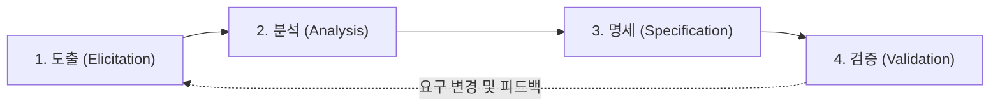

# 제2과목: 소프트웨어공학 종합 마스터 가이드

본 가이드는 정보시스템감리사 제2과목(소프트웨어공학)의 전 영역을 아우르는 심화 이론서로, 개발 방법론, 요구공학, 객체지향 설계 원칙(SOLID), GoF 디자인 패턴 23선, 마이크로서비스(MSA) 아키텍처, 테스트 커버리지 및 품질 표준(ISO/IEC 25010)을 깊이 있게 다룹니다.

---

## 1. 소프트웨어 개발 생명주기(SDLC) 및 개발 방법론

### (1) 전통적 생명주기 모델의 심층 비교

| 모델명 | 동작 메커니즘 | 장점 | 단점 및 위험 요소 | 대표 적용 분야 |
| :--- | :--- | :--- | :--- | :--- |
| **폭포수 모델 (Waterfall)** | 타당성 검토 $\rightarrow$ 계획 $\rightarrow$ 요구분석 $\rightarrow$ 설계 $\rightarrow$ 구현 $\rightarrow$ 시험 $\rightarrow$ 유지보수의 순차적 하향식 진행 | • 공정별 산출물이 명확하고 체계적 문서화 가능 • 일정 및 진척도 관리가 직관적 | • 후반부에 오류 발견 시 막대한 수정 비용 발생 (소급 수정 곤란) • 최종 배포 전까지 동작하는 SW 확인 불가 | 요구사항이 이미 명확하고 변경 가능성이 극히 낮은 공공 행정 시스템 |
| **프로토타이핑 모델 (Prototyping)** | 사용자의 핵심 요구사항을 바탕으로 견본품(시제품)을 신속 제작하여 검증 | • 사용자 요구사항의 조기 구체화 • 개발자와 사용자 간의 오해 최소화 | • 시제품이 최종 완성품으로 오인될 위험 • 잦은 수정으로 아키텍처 구조 왜곡 가능 | 요구사항이 불명확하거나 생소한 신규 UI/UX 중심 프로젝트 |
| **나선형 모델 (Spiral)** | **계획수립 $\rightarrow$ 위험분석 $\rightarrow$ 공학/개발 $\rightarrow$ 고객평가**의 4단계를 반복하며 시스템을 점진적으로 확장 | • **위험 분석 단계가 핵심**으로 기술적·관리적 리스크 조기 제거 • 대규모 프로젝트의 통제력 우수 | • 위험 분석 전문가의 역량에 프로젝트 성패 의존 • 공정이 복잡하여 관리 비용 증가 | 고난도의 신기술이 적용되는 대규모 국가 방위·우주 R&D 프로젝트 |
| **V-모델 (V-Model)** | 폭포수 모델의 각 개발 단계와 이에 대응하는 테스트 단계를 V자 형태로 매핑 | • 개발 초기부터 각 단계별 검증(Verification) 및 확인(Validation) 작업 체계화 | • 기본적으로 폭포수 기반이므로 요구 변경에 유연하지 못함 | 무결성과 신뢰성이 절대적인 임베디드, 의료기기, 자동차 제어 SW |

> **검증(Verification) vs 확인(Validation)**:
> - **검증 (Verification)**: "우리가 제품을 올바르게 만들고 있는가?" (Are we building the product right?) $\rightarrow$ 명세서와 표준에 부합하는지 개발자 관점에서 확인 (정적 시험, 인스펙션 등).
> - **확인 (Validation)**: "우리가 올바른 제품을 만들었는가?" (Are we building the right product?) $\rightarrow$ 사용자의 실제 의도와 요구에 부합하는지 사용자 관점에서 확인 (인수 시험 등).

---

### (2) 애자일(Agile) 개발 방법론 및 프레임워크

#### ① 애자일 선언문 4대 가치 & 12대 원칙
1.  프로세스와 도구보다 **개인과 상호작용**을
2.  포괄적인 문서보다 **작동하는 소프트웨어**를
3.  계약 협상보다 **고객과의 협력**을
4.  계획을 따르기보다 **변화에 대응하기**를

#### ② 스크럼 (Scrum) 프레임워크 3-5-3 체계
*   **3대 역할 (Roles)**:
    *   **제품 책임자 (PO: Product Owner)**: 제품 백로그(Product Backlog) 작성 및 우선순위 결정, 비즈니스 가치 극대화 책임.
    *   **스크럼 마스터 (SM: Scrum Master)**: 스크럼 원칙 준수 촉진, 팀의 장애물(Impediment) 제거, 코칭.
    *   **개발팀 (Developers)**: 교차 기능적(Cross-functional), 자기 조직화(Self-organizing)된 팀으로 실제 스프린트 목표 달성.
*   **5대 이벤트 (Events)**:
    1.  **스프린트 (Sprint)**: 1~4주 단위의 개발 사이클 (기간 고정 Timebox).
    2.  **스프린트 계획 회의 (Sprint Planning)**: 무엇을(What) 개발하고 어떻게(How) 수행할지 결정.
    3.  **일일 스크럼 (Daily Scrum)**: 매일 15분간 어제 한 일, 오늘 할 일, 장애 요인 공유.
    4.  **스프린트 리뷰 (Sprint Review)**: 스프린트 종료 시 완료된 결과물(Increment)을 이해관계자에게 데모 및 피드백 수집.
    5.  **스프린트 회고 (Sprint Retrospective)**: 팀의 프로세스, 관계, 도구 측면의 개선점을 점검하는 자기 반성 회의.
*   **3대 산출물 (Artifacts)**: 제품 백로그, 스프린트 백로그, 잠재적 출시 가능한 제품 증분(Increment).

#### ③ XP (eXtreme Programming) 핵심 실천항목 (Practices)
*   **TDD (Test-Driven Development)**: 실패하는 테스트 코드 작성(Red) $\rightarrow$ 통과하는 최소 코드 구현(Green) $\rightarrow$ 중복 제거 및 리팩토링(Refactor)의 반복.
*   **Pair Programming (짝 프로그래밍)**: 2인 1조로 한 명은 코드 작성(Driver), 다른 한 명은 설계와 전략을 점검(Navigator).
*   **CI/CD (지속적 통합)**: 하루에도 여러 번 코드를 통합하고 자동 빌드 및 자동 테스트 수행.
*   **Collective Code Ownership (공동 코드 소유권)**: 시스템의 어떤 코드든 누구나 수정할 수 있는 권한과 책임.

---

## 2. 요구공학 (Requirements Engineering)

### (1) 요구사항 분류 체계
*   **기능적 요구사항 (Functional)**: 시스템이 직접 수행해야 하는 기능, 연산, 입출력 데이터 흐름 (예: "회원은 계좌 비밀번호를 입력하여 잔액을 조회할 수 있어야 한다").
*   **비기능적 요구사항 (Non-Functional)**: 품질, 성능, 보안, 가용성, 규제 준수, 인터페이스 제약조건 (예: "동시 접속자 1만 명 환경에서 응답 시간은 2초 이내여야 한다", "모든 개인정보는 AES-256으로 암호화 저장되어야 한다").

### (2) 요구공학 4대 프로세스

1.  **요구사항 도출**: 인터뷰, 설문조사, 브레인스토밍, 워크숍, JAD(Joint Application Development), 프로토타이핑, 유스케이스 모델링.
2.  **요구사항 분석**: 요구사항 간의 상충(Conflict) 해결, 시스템 경계 결정. 구조적 분석(DFD, DD, 소단위명세서) 및 객체지향 분석(UML 다이어그램).
3.  **요구사항 명세 (IEEE 830 표준의 요구사항 명세서 우수 특성)**:
    *   **정확성(Correctness)**, **명확성(Unambiguous)**, **완전성(Completeness)**, **일관성(Consistency)**, **중요도/안정성 순위(Ranked)**, **검증가능성(Verifiable)**, **수정용이성(Modifiable)**, **추적가능성(Traceable)**.
4.  **요구사항 검증 및 정적 검토 기법**:
    *   **인스펙션 (Inspection)**: 공식적인 절차, 주재자(Moderator), 작성자, 낭독자, 검토자로 구성되어 체크리스트를 기반으로 결함을 검출하는 가장 엄격한 동료 검토.
    *   **워크스루 (Walkthrough)**: 작성자가 주도하여 산출물을 설명하고 비공식적으로 결함을 조기 발견하는 회의.

### (3) 요구사항 추적성 매트릭스 (RTM: Requirements Traceability Matrix)
제안요청서(RFP) 요구사항 $\leftrightarrow$ 요구사항정의서 $\leftrightarrow$ 아키텍처/상세설계서 $\leftrightarrow$ 소스코드 $\leftrightarrow$ 테스트 케이스 간의 양방향 추적성을 확보하여, 요구사항 누락(Missing) 및 무단 추가(Gold Plating)를 방지하는 감리의 핵심 점검 도구.

---

## 3. 객체지향 설계 5대 원칙 (SOLID) 완벽 해설

| 원칙 | 명칭 | 핵심 개념 | 위반 시 문제점 및 해결 패턴 |
| :---: | :--- | :--- | :--- |
| **S** | **단일 책임 원칙 (Single Responsibility)** | 클래스는 단 하나의 변경 이유만을 가져야 한다 (하나의 책임만 수행). | 하나의 클래스가 DB 접근, 비즈니스 로직, UI 출력을 모두 처리하면 수정 시 다른 기능에 파급 오류 발생. 클래스 분리 필요. |
| **O** | **개방-폐쇄 원칙 (Open-Closed)** | **확장에는 열려 있고(Open), 기존 코드의 수정에는 닫혀 있어야(Closed) 한다**. | 새로운 요구사항(예: 새로운 결제수단 추가) 시 기존 코드를 `if-else`로 직접 뜯어고쳐야 함. 인터페이스와 다형성을 적용하여 구현체만 추가하도록 설계. |
| **L** | **리스코프 치환 원칙 (Liskov Substitution)** | 서브타입은 언제나 자신의 기반타입(상위 클래스)으로 교체될 수 있어야 한다. | 자식 클래스가 부모의 계약(사전조건/사후조건)을 위반하여 부모 클래스의 기대 동작을 깨뜨림 (예: 직사각형을 상속받은 정사각형 문제). |
| **I** | **인터페이스 분리 원칙 (Interface Segregation)** | 클라이언트는 자신이 사용하지 않는 메서드에 의존하지 않아야 한다. | 너무 거대한 인터페이스로 인해 필요 없는 메서드까지 빈 껍데기로 구현해야 함. 인터페이스를 기능별로 잘게 쪼갬. |
| **D** | **의존 역전 원칙 (Dependency Inversion)** | 고수준 모듈은 저수준 모듈의 구현에 의존해서는 안 되며, 둘 다 **추상화(인터페이스)에 의존**해야 한다. | 비즈니스 로직이 구체적인 특정 DB 드라이버나 특정 파일 포맷 클래스를 직접 `new`하여 결합도가 극대화됨. Spring DI/IoC 활용. |

---

## 4. GoF 디자인 패턴 23선 완벽 정리

GoF(Gang of Four) 패턴은 생성(5개), 구조(7개), 행위(11개) 총 23개 패턴으로 구성됩니다.

### (1) 생성 패턴 (Creational Patterns - 5개)
객체의 생성과 조합을 캡슐화하여 시스템이 객체 생성 방식에 독립적이도록 지원.

1.  **Singleton (싱글톤)**: 클래스의 인스턴스가 오직 하나만 생성되도록 보장하고, 어디서든 접근할 수 있는 전역 접근점 제공. (DB Connection Pool 등).
2.  **Factory Method (팩토리 메서드)**: 객체 생성을 위한 인터페이스를 정의하되, 어떤 클래스의 인스턴스를 생성할지는 서브클래스가 결정하도록 위임.
3.  **Abstract Factory (추상 팩토리)**: 구체적인 클래스에 의존하지 않고, 서로 연관되거나 의존적인 객체들의 조합(제품군)을 생성하는 인터페이스 제공. (예: Windows용 버튼/텍스트박스 vs Mac용 버튼/텍스트박스 제품군).
4.  **Builder (빌더)**: 복잡한 객체의 생성 과정과 표현 방법을 분리하여, 동일한 생성 절차에서 서로 다른 표현의 객체를 생성. (생성자 인자가 많을 때 유용).
5.  **Prototype (프로토타입)**: 기존 객체를 복제(Clone)하여 새로운 객체를 생성. 객체 생성 비용이 매우 클 때 유용.

---

### (2) 구조 패턴 (Structural Patterns - 7개)
클래스나 객체들을 조합하여 더 큰 구조로 만드는 패턴.

1.  **Adapter (어댑터)**: 호환되지 않는 인터페이스를 가진 두 클래스를 연결하여 함께 작동할 수 있도록 변환해 주는 래퍼(Wrapper).
2.  **Bridge (브리지)**: 구현부에서 추상층을 분리하여 각자 독립적으로 확장할 수 있게 함 (추상화 계층구조와 구현 계층구조의 분리).
3.  **Composite (컴포지트)**: 객체들의 관계를 트리 구조로 구성하여 복합 객체(폴더)와 단일 객체(파일)를 동일한 인터페이스로 다룰 수 있게 함.
4.  **Decorator (데코레이터)**: 객체에 동적으로 새로운 책임(기능)을 추가. 서브클래스를 만드는 상속 대신 객체를 감싸서 유연하게 기능을 확장.
5.  **Facade (퍼사드)**: 복잡한 서브시스템 클래스들에 대해 단순화된 고수준의 단일 통합 인터페이스를 제공.
6.  **Flyweight (플라이웨이트)**: 크기가 작은 객체들을 공유(Sharing)하여 메모리 사용량을 대폭 절감 (문자 폰트, 게임 파티클 등).
7.  **Proxy (프록시)**: 실제 객체에 대한 접근을 제어하거나 부가 기능을 수행하기 위해 대리자/자리표시자 객체를 제공 (가상 프록시, 원격 프록시, 보호 프록시).

---

### (3) 행위 패턴 (Behavioral Patterns - 11개)
객체 간의 알고리즘, 책임 할당 및 상호작용을 정의.

1.  **Strategy (전략)**: 동일 계열의 알고리즘군을 정의하고 각각을 캡슐화하여 런타임에 동적으로 상호 교체할 수 있도록 만듦.
2.  **Observer (옵서버)**: 한 객체의 상태가 바뀌면 그 객체에 의존하는 모든 객체에게 자동으로 알림이 가고 내용이 갱신되는 1:N 의존 관계 (발행-구독 모델).
3.  **Template Method (템플릿 메서드)**: 상위 클래스에서 알고리즘의 골격(뼈대)을 정의하고, 세부 단계의 구체적 구현은 서브클래스에서 재정의하도록 위임.
4.  **Command (커맨드)**: 요청을 객체로 캡슐화하여 매개변수화, 요청 큐잉, 로깅, 작업 취소(Undo)를 지원.
5.  **State (상태)**: 객체의 내부 상태가 바뀜에 따라 행동을 변경할 수 있게 하여 객체가 마치 클래스를 바꾸는 것처럼 동작.
6.  **Iterator (반복자)**: 내부 표현부를 노출하지 않고도 복합 객체의 원소들을 순차적으로 접근할 수 있는 방법을 제공.
7.  **Chain of Responsibility (책임 연쇄)**: 요청을 처리할 수 있는 객체들을 체인 형태로 연결하여, 요청을 보낸 쪽과 받는 쪽의 결합을 분리.
8.  **Mediator (중재자)**: 객체들 간의 복잡한 상호작용을 단일 중재자 객체에 캡슐화하여 객체 간 결합도를 낮춤 (M:N 관계를 1:N으로 단순화).
9.  **Memento (메멘토)**: 캡슐화를 위반하지 않고 객체의 내부 상태를 저장해 두었다가 나중에 해당 상태로 복구할 수 있게 함 (스냅샷/Undo 지원).
10. **Visitor (방문자)**: 객체 구조의 요소들을 변경하지 않고도 그 요소들에 수행할 새로운 연산을 동적으로 추가.
11. **Interpreter (해석자)**: 특정 언어의 문법에 대한 표현을 정의하고 언어로 작성된 문장을 해석하는 인터프리터 제공.

---

## 5. 소프트웨어 아키텍처 및 마이크로서비스(MSA)

### (1) 아키텍처 스타일 비교
*   **Layered Architecture (계층형)**: 상위 계층은 하위 계층에만 의존하는 구조 (UI $\rightarrow$ 비즈니스 $\rightarrow$ 영속성 $\rightarrow$ DB). 관심사 분리 우수.
*   **Event-Driven Architecture (이벤트 기반)**: 이벤트 생산자(Producer), 이벤트 브로커(Kafka/RabbitMQ), 이벤트 소비자(Consumer)로 구성. 비동기식 완전한 느슨한 결합.
*   **Microservices Architecture (MSA)**: 비즈니스 도메인(DDD의 Bounded Context) 단위로 서비스를 독립적으로 분할, 독자적인 DB를 보유하며 경량 API(REST/gRPC)로 통신.

### (2) MSA 분산 트랜잭션: 사가 패턴 (Saga Pattern)
전통적인 2PC(Two-Phase Commit)는 분산 환경에서 블로킹으로 인해 성능이 저하되므로, 로컬 트랜잭션의 연속과 **보상 트랜잭션(Compensating Transaction)**을 사용하는 사가 패턴을 채택:
*   **Choreography Saga (코레오그래피)**: 중앙 조정자 없이 각 서비스가 이벤트를 발행하고 타 서비스의 이벤트를 구독하여 로컬 트랜잭션을 실행.
*   **Orchestration Saga (오케스트레이션)**: 중앙의 사가 오케스트레이터가 어떤 서비스를 호출하고 실패 시 어떤 보상 트랜잭션을 실행할지 순차적으로 지시.

---

## 6. 소프트웨어 테스트 기법 및 커버리지 정밀 분석

### (1) 화이트박스 테스트 커버리지 기준 (단골 킬러 문항)

다음 복합 조건문을 기준으로 커버리지 충족 조건을 분석합니다:
$$\text{IF } (A > 0 \text{ AND } B > 0) \text{ THEN ...}$$

1.  **구문 커버리지 (Statement Coverage, Line Coverage)**:
    *   코드 내의 **모든 실행 가능한 문장(Statement)을 최소 한 번 실행**.
2.  **분기/결정 커버리지 (Branch / Decision Coverage)**:
    *   전체 조건문의 결과가 **True가 되는 경우와 False가 되는 경우를 최소 한 번씩 모두 실행**.
3.  **조건 커버리지 (Condition Coverage)**:
    *   전체 결과와 무관하게, 조건문 내부의 **개별 조건식($A>0$, $B>0$) 각각이 True와 False를 최소 한 번씩 만족**.
4.  **MC/DC (Modified Condition / Decision Coverage - 최고 빈출)**:
    *   항공 소프트웨어(DO-178C) 및 자동차(ISO 26262) 표준.
    *   **각 개별 조건식이 '다른 조건식들의 결과에 영향을 받지 않고 독자적으로' 전체 결정문의 결과를 변경할 수 있음을 입증**.
    *   $N$개의 개별 조건식이 있을 때, **최소 $N+1$개의 테스트 케이스**로 다중조건 커버리지 수준의 신뢰성을 달성.

---

## 7. 소프트웨어 품질 표준 (ISO/IEC 25010 SQuaRE)

ISO/IEC 25010은 시스템 및 소프트웨어 제품 품질을 **8대 주특성 및 31개 부특성**으로 정의합니다.

| 주특성 | 정의 | 세부 부특성 (Sub-characteristics) |
| :--- | :--- | :--- |
| **1. 기능 적합성** | 명시적/묵시적 요구를 만족하는 기능을 제공하는 정도 | **기능 완전성, 기능 정확성, 기능 적절성** |
| **2. 성능 효율성** | 자원의 사용량 대비 제공되는 성능 수준 | **시간 반응성(응답시간), 자원 활용성(CPU/메모리), 용량 수용성** |
| **3. 호환성** | 동일한 환경을 공유하며 타 시스템과 정보를 교환하는 정도 | **공존성, 상호운용성** |
| **4. 사용성** | 사용자가 시스템을 이해하고 학습하며 만족스럽게 사용하는 정도 | **적합 인식성, 학습 용이성, 운영 용이성, 사용자 오류 방지성, UI 심미성, 접근성** |
| **5. 신뢰성** | 특정 조건에서 일정 기간 동안 지정된 수준의 성능을 유지하는 정도 | **성숙성, 가용성, 내결함성(Fault Tolerance), 복구성** |
| **6. 보안성** | 권한이 없는 자의 접근을 막고 데이터와 시스템을 보호하는 정도 | **기밀성, 무결성, 부인방지, 책임성, 인증성** |
| **7. 유지보수성** | 소프트웨어가 효과적이고 효율적으로 수정될 수 있는 정도 | **모듈성, 재사용성, 분석성, 수정성, 시험성** |
| **8. 이식성** | 한 운영환경에서 다른 환경으로 성공적으로 이전될 수 있는 정도 | **적응성, 설치성, 대체성** |
