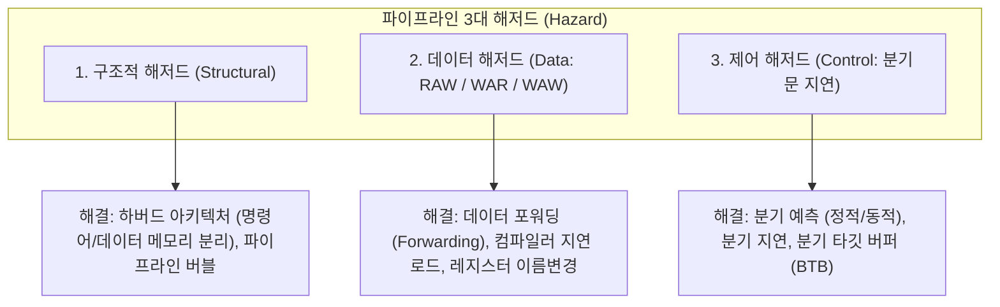
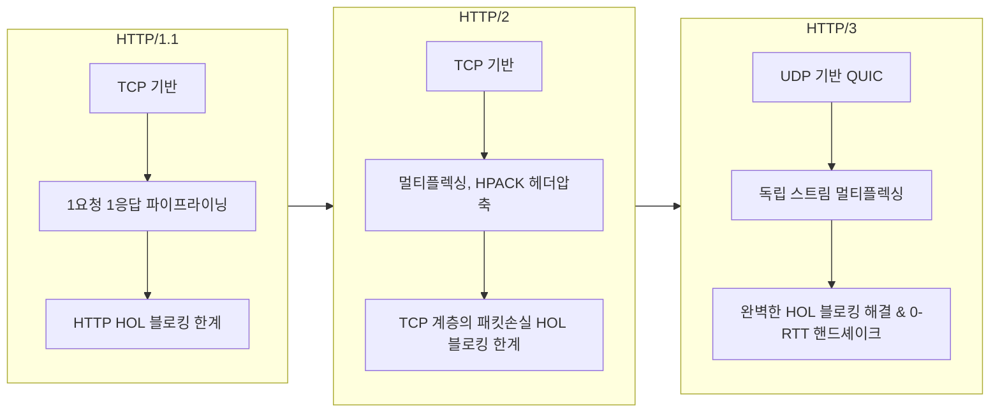

# 제4과목: 시스템구조 종합 마스터 가이드

본 가이드는 정보시스템감리사 제4과목(시스템구조)의 출제 범위를 집대성한 심화 이론서로, 컴퓨터 구조(파이프라인 해저드, 캐시 매핑/MESI), 운영체제(스케줄링, 교착상태 은행원 알고리즘, 가상메모리/스레싱), 컴퓨터 네트워크(서브넷팅, 라우팅, TCP 혼잡제어, HTTP/3), 클라우드 및 스토리지/DR 아키텍처를 체계적으로 다룹니다.

---

## 1. 컴퓨터 구조 및 프로세서 아키텍처

### (1) 프로세서 분류 및 명령어 아키텍처 (CISC vs RISC)

| 비교 항목 | **CISC (Complex Instruction Set Computer)** | **RISC (Reduced Instruction Set Computer)** |
| :--- | :--- | :--- |
| **명령어 특성** | 복잡하고 다양한 기능의 가변 길이 명령어 (수백 개) | 단순하고 직관적인 고정 길이(통상 32/64비트) 명령어 (수십 개) |
| **명령어 실행 주기** | 명령어당 여러 클록 사이클 소요 (Multi-cycle) | **명령어당 1 클록 사이클 실행 (1 CPI 지향)** |
| **메모리 접근** | 연산 명령어가 메모리에 직접 접근 가능 | **오직 Load/Store 명령어만 메모리 접근 가능** (레지스터 기반 연산) |
| **레지스터 수** | 상대적으로 적음 (소수 범용 레지스터) | **매우 많음 (32개 이상의 풍부한 레지스터)** |
| **파이프라이닝** | 가변 길이로 인해 파이프라인 구현이 매우 복잡 | **고정 길이와 정형화된 포맷으로 파이프라이닝에 최적화** |
| **제어 유닛** | 마이크로프로그램 제어 방식 (ROM) | 하드와이어드(Hardwired) 고속 논리회로 제어 방식 |
| **대표 프로세서** | Intel x86, AMD (현대는 내부적으로 RISC 마이크로 연산으로 변환) | ARM, MIPS, RISC-V, Apple Silicon |

---

### (2) 명령어 파이프라인 5단계 및 3대 해저드(Hazard) 심층 분석

표준 5단계 파이프라인: **IF (인출) $\rightarrow$ ID (해독/레지스터 읽기) $\rightarrow$ EX (실행/ALU 연산) $\rightarrow$ MEM (메모리 접근) $\rightarrow$ WB (레지스터 결과 쓰기)**

#### ① 구조적 해저드 (Structural Hazard)
*   **원인**: 두 개 이상의 파이프라인 단계가 동일한 물리적 하드웨어 자원을 동시에 사용하려 할 때 발생 (예: 폰 노이만 구조에서 IF 단계의 명령어 메모리 인출과 MEM 단계의 데이터 메모리 읽기/쓰기가 단일 버스에서 충돌).
*   **해결책**:
    *   **하버드 아키텍처 (Harvard Architecture)**: 명령어 캐시(I-Cache)와 데이터 캐시(D-Cache)를 물리적으로 완전 분리.
    *   **파이프라인 스톨 (Stall / Bubble 삽입)**: 자원이 해제될 때까지 1클록 지연.

#### ② 데이터 해저드 (Data Hazard)
*   **원인**: 명령어 간의 데이터 의존성으로 인해 이전 명령어의 결과가 준비되지 않은 상태에서 다음 명령어가 값을 참조할 때 발생.
    1.  **RAW (Read After Write - 진성 데이터 의존성 True Dependency)**:
        *   $I_1$이 레지스터 $R_1$에 값을 쓰기(WB) 전에 $I_2$가 $R_1$을 읽으려(ID) 할 때 발생 (가장 흔함).
        *   **해결책**: **데이터 포워딩 (Data Forwarding / Bypassing)** $\rightarrow$ ALU 연산 결과(EX 단계 끝)를 레지스터 파일 쓰기까지 기다리지 않고 내부 버스를 통해 다음 명령어의 EX 단계 입력 멀티플렉서로 직접 우회 전달하여 스톨 제거.
    2.  **WAR (Write After Read - 반의존성 Anti-Dependency)**:
        *   $I_1$이 값을 읽기 전에 $I_2$가 먼저 그 레지스터에 값을 써버릴 때 발생 (순차 실행에서는 발생하지 않고, 비순차적 실행 Out-of-Order 프로세서에서 발생).
    3.  **WAW (Write After Write - 출력의존성 Output Dependency)**:
        *   $I_1$이 값을 쓰기 전에 $I_2$가 먼저 값을 써버려 최종 레지스터 값이 왜곡될 때 발생.
*   **WAR / WAW 해결책**: 한정된 논리 레지스터 이름을 가상화하여 물리 레지스터로 동적 매핑하는 **레지스터 이름 변경 (Register Renaming)** 기법으로 완벽히 제거 (WAR와 WAW는 가짜 의존성임).

#### ③ 제어 해저드 (Control Hazard)
*   **원인**: 조건 분기문(Branch)의 조건 만족 여부 및 목적지 주소가 EX 단계(또는 ID 단계)에서 결정되기 전까지, 다음에 인출해야 할 명령어 주소를 확정할 수 없어 발생.
*   **해결책**:
    *   **분기 지연 (Delayed Branch)**: 분기문 바로 다음 슬롯(Branch Delay Slot)에 분기 여부와 상관없이 항상 실행해야 하는 유용한 독립 명령어를 컴파일러가 배치.
    *   **정적 분기 예측 (Static)**: 항상 분기하지 않는다고 가정(Predict-Not-Taken)하거나, 루프문은 항상 뒤로 분기(Backward-Taken), 일반 조건문은 앞으로 분기(Forward-Not-Taken) 예측.
    *   **동적 분기 예측 (Dynamic)**: 과거 분기 이력을 2비트 포화 계수기(2-bit Saturating Counter: Strongly Taken, Weakly Taken, Weakly Not-Taken, Strongly Not-Taken)로 추적하여 런타임에 90% 이상의 적중률로 예측.
    *   **분기 타깃 버퍼 (BTB: Branch Target Buffer)**: 분기 명령어 주소와 예측된 목적지 주소를 캐시 형태로 보관하여 IF 단계에서 즉시 타깃 주소로 페치.

---

## 2. 메모리 계층 및 캐시 메모리 아키텍처

### (1) 캐시 메모리 주소 매핑 3대 방식 정밀 계산

메모리 주소가 $M$비트일 때, 캐시 매핑 방식에 따른 주소 필드 분할 구조:

| 매핑 방식 | 메모리 주소 필드 분할 | 동작 메커니즘 | 장단점 비교 |
| :--- | :--- | :--- | :--- |
| **직접 매핑 (Direct Mapping)** | `[ Tag ] [ Index ] [ Offset ]` | 메모리 블록 번호를 캐시 라인 수로 모듈로($\bmod$) 연산하여 **정해진 단 하나의 라인에만 저장** | • 구조와 검색 하드웨어가 극히 단순하고 빠름 • 동일 인덱스를 갖는 블록들이 경합할 때 **충돌 미스(Conflict Miss) 빈발** |
| **완전 연관 매핑 (Fully Associative)** | `[ Tag ] [ Offset ]` (Index 필드 없음) | 캐시의 **어떤 라인이든 빈 곳에 저장 가능** | • 충돌 미스가 발생하지 않아 적중률이 가장 높음 • 모든 태그를 동시에 비교해야 하므로 **고가의 연관 메모리(CAM) 회로 필요, 비용/전력 극대화** |
| **세트 연관 매핑 (Set-Associative)** | `[ Tag ] [ Set Index ] [ Offset ]` | 캐시 라인들을 여러 개(예: 2/4/8개) 묶어 하나의 세트(Set)를 구성. **세트는 인덱스로 매핑되고 세트 내에서는 어디든 저장** | • 직접 매핑과 완전 연관의 절충안 (현대 CPU 표준) • $N$-way Set Associative ($N$개의 태그만 동시 비교) |

### (2) 캐시 쓰기 정책 (Write Policy)
*   **Write-Through (연속 쓰기)**: 캐시와 메인 메모리에 동시에 데이터를 기록. 구현이 단순하고 일관성이 완벽하지만 메모리 버스 트래픽이 커짐.
*   **Write-Back (후기 쓰기)**: 캐시에만 먼저 기록하고 변경 표시 비트(Dirty Bit)를 1로 세팅한 후, 나중에 해당 캐시 블록이 다른 데이터로 교체될 때 비로소 메인 메모리에 일괄 갱신. 성능이 매우 우수하지만 일관성 관리가 복잡.
*   *Write Allocate (쓰기 할당)*: 쓰기 미스 발생 시 메인 메모리 블록을 캐시로 먼저 적재한 후 쓰기 수행 (Write-Back과 짝).
*   *No-Write Allocate (비할당)*: 쓰기 미스 시 캐시를 거치지 않고 메인 메모리에 직접 기록 (Write-Through와 짝).

### (3) 캐시 일관성 (Cache Coherence) MESI 프로토콜
멀티코어/멀티프로세서 환경에서 동일 메모리 주소를 여러 코어의 L1/L2 캐시가 공유할 때 일관성을 유지하는 스누핑(Snooping) 기반 표준 4대 상태:
1.  **Modified (수정)**: 해당 블록이 이 캐시에만 존재하며, 주 메모리의 값과 다르게 수정된 상태 (Dirty).
2.  **Exclusive (배타/독점)**: 해당 블록이 이 캐시에만 존재하지만, 주 메모리의 값과 일치하는 상태 (Clean).
3.  **Shared (공유)**: 해당 블록이 여러 캐시에 동시에 복제되어 존재할 수 있으며, 주 메모리와 일치하는 상태.
4.  **Invalid (무효)**: 해당 블록의 내용이 유효하지 않은 상태 (다른 코어가 값을 수정하여 무효화됨).

---

## 3. 운영체제 (Operating System) 심화 이론

### (1) 프로세스 동기화 및 임계구역 3대 필수 조건
*   **상호 배제 (Mutual Exclusion)**: 하나의 프로세스가 임계구역에서 실행 중이면 다른 어떤 프로세스도 그 임계구역에 들어갈 수 없다.
*   **진행 (Progress)**: 임계구역에서 실행 중인 프로세스가 없을 때, 진입을 원하는 프로세스들 중에서 적절히 다음 진입자를 결정해야 하며 이 결정이 무한정 연기되어서는 안 된다.
*   **유한 대기 (Bounded Waiting)**: 프로세스가 임계구역 진입을 요청한 후 허용될 때까지 다른 프로세스들의 진입 횟수에 제한(한계)이 있어야 한다 (기아 상태 Starvation 방지).

### (2) 교착상태 (Deadlock) 발생 4대 조건 및 다익스트라 은행원 알고리즘
*   **4대 필요조건 (모두 만족해야 발생)**:
    1.  **상호 배제 (Mutual Exclusion)**: 자원은 한 번에 한 프로세스만 사용 가능.
    2.  **점유와 대기 (Hold and Wait)**: 최소 하나의 자원을 보유한 채 다른 자원을 대기.
    3.  **비선점 (Non-preemption)**: 자원을 강제로 빼앗을 수 없음.
    4.  **환형 대기 (Circular Wait)**: 대기 프로세스들이 원형 체인을 형성.
*   **다익스트라 은행원 알고리즘 (Banker's Algorithm - 회피 기법)**:
    *   자원 할당 전, 시스템이 **안전 상태(Safe State)**를 유지할 수 있는지 시뮬레이션.
    *   모든 프로세스가 요구할 수 있는 최대 자원량($Max$), 현재 할당량($Allocation$), 가용 자원량($Available$), 향후 추가 요구량($Need = Max - Allocation$).
    *   시스템에 $Need \le Available$을 만족하는 프로세스가 순차적으로 실행되어 끝마칠 수 있는 **안전 순서열(Safe Sequence)**이 하나라도 존재하면 안전 상태로 판정하여 자원을 할당함.

### (3) 가상 메모리 관리: 페이징, 세그멘테이션 및 스레싱(Thrashing)
*   **페이징 (Paging)**: 물리 메모리를 프레임(Frame), 가상 메모리를 페이지(Page)라는 **동일한 고정 크기 블록**으로 분할 관리. 외부 단편화는 발생하지 않으나 마지막 페이지에서 **내부 단편화(Internal Fragmentation)** 발생.
*   **세그멘테이션 (Segmentation)**: 코드, 데이터, 스택 등 논리적 의미 단위로 **가변 크기 블록**으로 분할. 내부 단편화는 없으나 메모리 할당/해제 반복 시 빈 공간 조각이 발생하는 **외부 단편화(External Fragmentation)** 발생.
*   **스레싱 (Thrashing)**:
    *   프로세스의 원활한 수행에 필요한 최소 프레임이 부족하여, **프로세스가 실행하는 시간보다 페이지 부재(Page Fault)로 인해 디스크 I/O를 수행하는 시간이 더 많아져 CPU 이용률이 급격히 0으로 수렴하는 현상**.
    *   **해결책**:
        *   **작업 집합 (Working Set) 모델**: 프로세스가 일정 시간($\Delta$, 윈도우 크기) 동안 자주 참조하는 페이지들의 집합을 메모리에 상주 보장.
        *   **페이지 부재 빈도 (PFF: Page Fault Frequency) 조절**: 페이지 부재율의 상한선과 하한선을 설정하여, 상한선을 초과하면 프레임을 추가 할당하고 하한선 아래로 떨어지면 프레임을 회수.

---

## 4. 컴퓨터 네트워크 및 인터넷 프로토콜

### (1) IP 서브넷팅 및 VLSM 계산법
IPv4 주소 32비트 = 네트워크 ID 비트 + 호스트 ID 비트.
*   **서브넷 마스크 $/N$**: 상위 $N$비트가 1.
*   **호스트 개수 수식**:
    *   전체 할당 IP 수: $2^{(32 - N)}$
    *   **실제 컴퓨터/서버에 부여 가능한 가용 호스트 수**: $\mathbf{2^{(32 - N)} - 2}$ (모든 호스트 비트가 0인 네트워크 주소와, 모든 호스트 비트가 1인 브로드캐스트 주소 제외).

> **[실전 계산 예제]** `172.16.0.0/20` 네트워크를 동일한 크기의 서브넷 8개로 분할할 때, 각 서브넷의 서브넷 마스크와 가용 호스트 수는?
> 1.  8개의 서브넷으로 쪼개려면 $2^3 = 8$이므로 네트워크 비트를 3비트 더 빌려와야 함.
> 2.  새로운 서브넷 프리픽스 = $20 + 3 = \mathbf{/23}$.
> 3.  서브넷 마스크 = 23개의 1과 9개의 0 $\implies$ `11111111.11111111.11111110.00000000` $\implies$ $\mathbf{255.255.254.0}$.
> 4.  각 서브넷당 남은 호스트 비트 수 = $32 - 23 = 9$비트.
> 5.  서브넷당 가용 호스트 수 = $2^9 - 2 = 512 - 2 = \mathbf{510\text{대}}$.

---

### (2) 라우팅 프로토콜(IGP vs EGP) 및 동작 원리

| 구분 | **RIP (Routing Information Protocol)** | **OSPF (Open Shortest Path First)** | **BGP (Border Gateway Protocol)** |
| :--- | :--- | :--- | :--- |
| **분류** | IGP (내부 라우팅) | IGP (내부 라우팅) | **EGP (서로 다른 AS 간 외부 라우팅)** |
| **알고리즘** | **거리 벡터 (Distance Vector)** (Bellman-Ford 알고리즘) | **링크 상태 (Link State)** (Dijkstra 최단경로 SPF) | **경로 벡터 (Path Vector)** |
| **메트릭(비용)**| **단순 홉 수 (Hop Count, 최대 15)** | **대역폭(Bandwidth) 기반 링크 비용** | **AS-Path (통과하는 AS 목록), 다양한 정책 속성** |
| **토폴로지 인식**| 인접 라우터의 라우팅 테이블만 복제 | **Area 단위로 전체 네트워크 토폴로지 데이터베이스(LSDB) 완전 구축** | 전체 AS 경로 인식 (루프 완전 방지) |
| **수렴 속도** | 주기적(30초) 전체 테이블 전송 $\rightarrow$ **매우 느림, Count-to-Infinity 문제** | 변경 발생 시에만 LSA 플러딩 $\rightarrow$ **매우 빠름** | 경로 변경 시 업데이트 $\rightarrow$ 안정적 |
| **적용 규모** | 소규모 LAN 환경 | 대규모 기업망, 엔터프라이즈 | **전 세계 인터넷 백본망** |

---

### (3) HTTP 프로토콜의 혁신적 진화 비교 (HTTP/1.1 vs HTTP/2 vs HTTP/3)

| 기능 / 특성 | **HTTP/1.1** | **HTTP/2** | **HTTP/3** |
| :--- | :--- | :--- | :--- |
| **전송 계층 프로토콜** | **TCP** | **TCP** | **UDP (QUIC 프로토콜 기반)** |
| **다중화 (Multiplexing)** | 미지원 (순차적 처리 또는 복수 TCP 연결 생성) | **단일 TCP 연결 내 멀티플렉싱 지원** (스트림 기반) | **완벽한 멀티플렉싱** (스트림별 완전 독립) |
| **HOL 블로킹 해결 수준** | **미해결** (앞선 HTTP 응답이 지연되면 뒤의 모든 요청 대기) | **HTTP 계층은 해결**, 단 **TCP 패킷 손실 시 전체 스트림 일시 중단(TCP HOL 발생)** | **전송 계층(UDP)부터 완벽 해결** (1개 스트림 패킷이 유실되어도 타 스트림 정상 전송) |
| **연결 수립 지연** | 3-Way Handshake (1.5 RTT) + TLS (1~2 RTT) | 동일 | **0-RTT 또는 1-RTT** (연결 수립과 암호 핸드셰이크 동시 완료) |
| **네트워크 변경 (핸드오버)** | IP/Port 변경 시 TCP 재연결 필요 (끊김) | 동일 | **Connection ID 기반**으로 Wi-Fi $\leftrightarrow$ LTE 이동 시에도 끊김 없이 세션 유지 |
