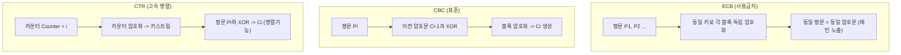
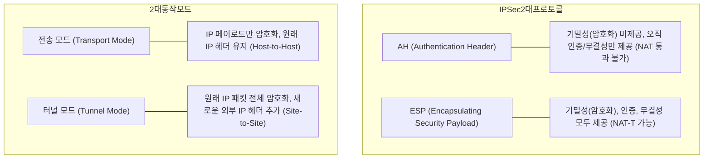

# 제5과목: 보안 종합 마스터 가이드

본 가이드는 정보시스템감리사 제5과목(보안)의 전 출제 범위를 아우르는 심화 이론서로, 암호학(대칭키/공개키/해시/블록모드), 네트워크 및 시스템 보안 공격/방어 기법, 웹 취약점 및 시큐어 코딩(소프트웨어 보안약점 49선), 제로 트러스트(Zero Trust) 및 클라우드 보안, 개정 개인정보보호법 및 ISMS-P 인증기준을 완벽히 정리합니다.

---

## 1. 암호학 (Cryptography) 심층 해설

### (1) 대칭키 블록 암호 5대 운용 모드 (Block Cipher Modes) 정밀 비교

블록 암호는 고정된 크기(예: 128비트) 단위로 암호화를 수행하므로, 가변 길이의 긴 평문을 안전하게 암호화하기 위해 운용 모드를 적용합니다.

| 모드명 | 암호화 연산 구조 | 초기화 벡터(IV) | 암호화 병렬 처리 | 복호화 병렬 처리 | 1비트 전송 오류 발생 시 파급 효과 (Error Propagation) |
| :--- | :--- | :---: | :---: | :---: | :--- |
| **ECB (Electronic Codebook)** | 각 평문 블록을 독립적으로 암호화 ($C_i = E_K(P_i)$) | 불필요 | **가능** | **가능** | • 해당 블록의 암호문만 오류 발생 • **[치명적 단점] 동일 평문 블록은 항상 동일 암호문 생성 $\rightarrow$ 패턴 누출로 실무 사용 금지** |
| **CBC (Cipher Block Chaining)** | 평문 블록을 **이전 암호문 블록과 XOR 연산 후 암호화** ($C_i = E_K(P_i \oplus C_{i-1})$) | **필수** | **불가능** (순차적 진행) | **가능** (모든 $C$가 주어짐) | • 암호문 $C_i$ 전송 중 1비트 왜곡 시: **복호화 시 $P_i$ 전체가 손상되고, 다음 평문 $P_{i+1}$의 동일 위치 1비트가 왜곡됨** (이후 정상 복구) |
| **CFB (Cipher Feedback)** | 이전 암호문을 암호화한 출력과 평문을 XOR하여 암호문 생성 (블록을 스트림화) | **필수** | **불가능** | **가능** | • 암호문 1비트 오류 시: 해당 평문 1비트 왜곡 + 이후 블록 전체 오류 파급 |
| **OFB (Output Feedback)** | IV를 계속 암호화하여 키 스트림을 생성하고 이를 평문과 XOR (스트림 암호화) | **필수** | **불가능** | **불가능** | • 암호문 1비트 왜곡 시: **오직 해당 평문 1비트만 왜곡되고 타 블록 파급 없음** (영상/음성 통신에 유리) |
| **CTR (Counter)** | 1씩 증가하는 카운터를 암호화하여 키 스트림을 생성한 후 평문과 XOR | **필수 (Nonce)**| **완전 가능** | **완전 가능** | • 암호문 1비트 왜곡 시: 오직 해당 평문 1비트만 왜곡 • **랜덤 액세스 및 멀티코어 병렬 연산 최강** |

> **GCM (Galois/Counter Mode)**: CTR 모드의 초고속 기밀성 암호화에 Galois Field 곱셈 연산을 통한 인증 태그(GMAC) 생성을 결합한 **인증 암호화(AEAD: Authenticated Encryption with Associated Data)** 표준. TLS 1.3의 핵심 모드.

---

### (2) 공개키(비대칭키) 암호 알고리즘 수학적 메커니즘

#### ① RSA 암호 알고리즘 (소인수분해 난제)
1.  **키 생성 단계**:
    *   두 개의 서로 다른 큰 소수 $p$와 $q$를 비밀리에 선택.
    *   $n = p \times q$를 계산 (공개 모듈러스).
    *   오일러 피 함수 값 $\phi(n) = (p - 1)(q - 1)$을 계산.
    *   $\phi(n)$과 서로소인 정수 $e$를 선택 ($1 < e < \phi(n), \gcd(e, \phi(n)) = 1$).
    *   확장 유클리드 호제법을 이용하여 $e$의 모듈로 $\phi(n)$에 대한 곱셈 역원 $d$를 구함:
        $$\mathbf{e \times d \equiv 1 \pmod{\phi(n)}}$$
    *   **공개키 (Public Key)**: $(e, n)$
    *   **개인키 (Private Key)**: $(d, n)$
2.  **암호화 및 복호화**:
    *   암호화: $C = M^e \pmod{n}$
    *   복호화: $M = C^d \pmod{n}$

#### ② Diffie-Hellman 키 교환 프로토콜 (이산대수 난제)
*   안전하지 않은 공개 채널에서 두 당사자가 공통의 대칭 비밀키를 수립하는 방식.
    1.  공개 매개변수: 큰 소수 $p$와 생성자 $g$를 공개 공유.
    2.  앨리스는 비밀값 $a$를 선택 후 $A = g^a \bmod p$를 밥에게 전송.
    3.  밥은 비밀값 $b$를 선택 후 $B = g^b \bmod p$를 앨리스에게 전송.
    4.  앨리스는 $K = B^a \bmod p = (g^b)^a \bmod p$ 계산.
    5.  밥은 $K = A^b \bmod p = (g^a)^b \bmod p$ 계산.
    6.  양자는 동일한 비밀 대칭키 $K = g^{ab} \bmod p$를 안전하게 공유.
*   *취약점*: **상대방에 대한 신원 인증 기능이 없어 중간자 공격(MITM: Man-in-the-Middle)에 취약** $\rightarrow$ 인증서 기반 디지털 서명(Station-to-Station 프로토콜) 결합 필요.

#### ③ ECC (Elliptic Curve Cryptography: 타원곡선 암호)
*   타원곡선 이산대수 문제(ECDLP)를 기반으로 함.
*   **압도적 장점**: **짧은 키 길이로도 RSA와 동등한 보안 강도를 제공** (ECC 256비트 $\approx$ RSA 3,072비트 급 강도).
*   연산 속도가 빠르고 키 저장 공간 및 대역폭을 절감하여 모바일 기기, 스마트카드, IoT 환경 표준.

---

## 2. 네트워크 공격 유형 및 시스템 보안

### (1) 서비스 거부 공격 (DoS / DDoS) 정밀 분석

| 공격 기법 | 동작 메커니즘 및 타깃 계층 | 탐지 및 대응 기법 |
| :--- | :--- | :--- |
| **SYN Flooding** | L4 계층. TCP 3-Way Handshake에서 대량의 SYN 패킷을 보내고 서버의 SYN+ACK에 ACK를 회신하지 않아, 서버의 **백로그 큐(Backlog Queue)를 반개방(Half-open) 상태로 고갈**시킴 | • **SYN Cookie** 활성화 (백로그 큐에 저장하지 않고 암호화된 시퀀스 번호 발송) • 백로그 큐 크기 확장, SYN 대기 타임아웃 단축 |
| **Smurf Attack** | L3 계층. 공격자가 출발지 IP를 희생자 IP로 위조(Spoofing)한 후, **네트워크 브로드캐스트 주소로 ICMP Echo Request를 발송**하여 대량의 Echo Reply가 희생자에게 집중되도록 유도 | • 라우터에서 **Direct Broadcast 차단** (`no ip directed-broadcast`) • 엔드포인트에서 ICMP 브로드캐스트 응답 비활성화 |
| **DRDoS (분산 반사 서비스 거부)** | L4/L7 계층. 출발지 IP를 희생자로 변조하여 **NTP(monlist), DNS(ANY 질의), Memcached, SSDP** 등 UDP 기반 공개 서버에 요청 전송 $\rightarrow$ 서버들이 **수십~수만 배 증폭된 응답 패킷을 희생자에게 일제히 쏟아부음** | • 반사 서버의 증폭 기능 비활성화 • ISP 라우터에서 **Ingress/Egress BCP 38 필터링 (위조 출발지 IP 패킷 차단)** |
| **Slowloris DoS** | L7 계층. HTTP 요청 헤더의 끝을 알리는 빈 줄(`\r\n\r\n`)을 보내지 않고, **비정상적으로 긴 간격으로 가짜 헤더를 조금씩 지속 전송**하여 웹 서버의 커넥션 풀을 장시간 독점 | • 웹 서버의 최소 데이터 전송 속도 및 요청 헤더 타임아웃 단축 • Reverse Proxy(Nginx)를 전면에 배치하여 완충 |

---

### (2) IPSec (IP Security) 프로토콜 스택 완벽 분석

*   **키 교환 프로토콜 (IKE: Internet Key Exchange)**:
    *   *1단계 (IKE Phase 1)*: 두 개체 간 보안 채널을 형성하기 위해 IKE SA 수립 (Main Mode: 6개 메시지 교환, 신원 보호 / Aggressive Mode: 3개 메시지 고속 교환, 신원 노출 위험).
    *   *2단계 (IKE Phase 2)*: 실제 데이터 통신을 보호하기 위한 IPSec SA 수립 (Quick Mode: 3개 메시지 교환).

---

## 3. 웹 애플리케이션 보안 및 시큐어 코딩 (KISA 보안약점 49선)

### (1) 웹 4대 핵심 취약점 비교 분석

| 취약점 | 공격 원리 | 핵심 발생 원인 | 확실한 시큐어 코딩 대응책 |
| :--- | :--- | :--- | :--- |
| **SQL Injection** | 사용자 입력값에 SQL 특수문자(`'`, `OR 1=1 --`)를 삽입하여 백엔드 DB 쿼리 구조를 임의 변조 | SQL 문장을 동적 문자열 결합(String Concatenation)으로 조립 | **PreparedStatement (파라미터화된 쿼리 Parameterized Query) 필수 사용**, 동적 쿼리 금지, 입력값 특수문자 화이트리스트 검증 |
| **XSS (Cross-Site Scripting)** | 게시판 등에 악성 스크립트(`<script>`)를 삽입하여 피해자의 브라우저에서 실행되도록 유도 | 사용자 입력을 화면에 출력할 때 HTML 태그 필터링 없이 그대로 렌더링 | **출력값 HTML 엔티티 인코딩**(`<` $\rightarrow$ `&lt;`, `"` $\rightarrow$ `&quot;`), 세션 쿠키에 **`HttpOnly` 플래그 설정**, CSP(Content Security Policy) 적용 |
| **CSRF (Cross-Site Request Forgery)**| 로그인된 사용자가 공격자가 만든 악성 링크/스크립트를 클릭하게 하여, 사용자의 신분으로 불법 요청을 서버로 전송 | 서버가 요청을 보낸 웹 페이지의 출처(Origin)를 확인하지 않고 쿠키 기반 자동 인증에만 의존 | **예측 불가능한 CSRF 토큰(Token) 검증**, 민감 작업 시 재인증(비밀번호/OTP), 쿠키의 **`SameSite` 속성을 Strict 또는 Lax로 설정** |
| **SSRF (Server-Side Request Forgery)**| 외부 접근이 차단된 내부 사설망이나 클라우드 메타데이터 서버(`169.254.169.254`)를 웹 서버의 권한으로 요청 전송 | 서버가 사용자로부터 URL을 입력받아 내부 네트워크 자원을 대신 조회할 때 | **외부 입력 URL에 대한 내부 IP/루프백 주소 화이트리스트 필터링**, 내부망 접근 프록시 격리 |

---

## 4. 제로 트러스트 (Zero Trust) 및 클라우드 보안

### (1) NIST SP 800-207 제로 트러스트 7대 기본 원칙
1.  모든 데이터 소스와 컴퓨팅 서비스는 **자원(Resource)**으로 간주한다.
2.  네트워크 위치(내부망 여부)에 상관없이 **모든 통신은 안전하게 보호(암호화)**되어야 한다.
3.  개별 자원에 대한 접근은 **세션 단위(Per-session)**로 동적으로 부여된다.
4.  자원에 대한 접근은 클라이언트 신원, 애플리케이션 상태, 접속 기기의 보안 태세 등을 종합적으로 평가하는 **동적 정책**에 의해 결정된다.
5.  기업은 모든 연결된 기기와 자산의 무결성과 보안 상태를 **지속적으로 모니터링하고 측정**한다.
6.  모든 자원 접근은 접근이 허용되기 전에 **동적으로 엄격히 인증 및 인가(명시적 검증)**된다.
7.  기업은 자산, 네트워크 인프라, 통신 상태에 대한 가능한 많은 정보를 수집하여 **보안 태세를 지속적으로 개선(침해 가정)**한다.

### (2) 제로 트러스트 논리적 구성요소
*   **PDP (Policy Decision Point: 정책 결정점)**:
    *   **정책 엔진 (Policy Engine: PE)**: 조직의 보안 정책과 위협 인텔리전스를 기반으로 자원 접근 승인 여부를 최종 결정하는 두뇌.
    *   **정책 관리자 (Policy Administrator: PA)**: PE의 결정을 받아 실제 통신 경로를 열거나 닫도록 명령을 내리는 관리기.
*   **PEP (Policy Enforcement Point: 정책 시행점)**: 사용자와 자원 사이의 게이트웨이 역할을 수행하며, PA의 지시에 따라 실제 세션을 수립, 차단, 모니터링하는 관문.

### (3) 클라우드 보안 핵심 모델
*   **CSPM (Cloud Security Posture Management)**: 클라우드 인프라(AWS/GCP/Azure)의 잘못된 설정(Misconfiguration, 열린 S3 버킷 등) 및 컴플라이언스 준수 여부를 자동 감사.
*   **CWPP (Cloud Workload Protection Platform)**: VM, 컨테이너, 서버리스 워크로드를 빌드부터 런타임까지 취약점 및 악성코드로부터 보호.
*   **CASB (Cloud Access Security Broker)**: 사용자와 클라우드 서비스(SaaS) 사이에 위치하여 접근 통제, 데이터 유출 방지(DLP), 암호화 제공.

---

## 5. 개인정보보호법 및 ISMS-P 인증기준

### (1) 개정 개인정보보호법 핵심 포인트 (단골 출제)
*   **과징금 산정 기준 변경**: 기존 "위반행위와 관련한 매출액의 3% 이하" $\rightarrow$ **"전체 매출액의 3% 이하"**로 대폭 상향 (단, 위반행위와 무관한 매출액은 제외할 수 있으며 입증책임은 기업에 있음).
*   **개인정보 전송요구권 (마이데이터)**: 정보주체가 본인의 개인정보를 본인 또는 제3의 공인 개인정보관리전문기관에 전송하도록 요구할 수 있는 법적 권리 신설.
*   **자동화된 결정에 대한 거부권 및 설명요구권**: 인공지능(AI) 등 완전 자동화된 시스템의 결정(예: 신용평가, 채용 심사)이 권리·의무에 중대한 영향을 미치는 경우 거부하거나 설명을 요구할 수 있음.
*   **개인정보 유출 신고 기준**: **1천 명 이상의 정보주체**에 관한 개인정보가 유출된 경우 **72시간 이내에 개인정보보호위원회 또는 KISA에 신고**하여야 함.

### (2) 개인정보 안전성 확보조치 기준 (고시) 암호화 규정
*   **고유식별정보 (주민등록번호, 여권번호, 운전면허번호, 외국인등록번호)**:
    *   정보통신망을 통해 송신하거나 보조저장매체 등을 통해 전달하는 경우 암호화 필수.
    *   **인터넷망 구간 및 DMZ에 저장하는 경우 암호화 필수**.
    *   내부망에 저장하는 경우에도 위험도 분석에 따라 암호화 적용 (단, **주민등록번호는 내부망 저장 시에도 예외 없이 100% 암호화 필수**).
*   **비밀번호**: **일방향 암호화(단방향 해시 함수 + Salt 적용)**로 저장 필수.
*   **바이오정보**: 암호화하여 저장 필수.
*   **접속기록의 보관 및 점검**: 개인정보처리시스템의 접속기록은 **최소 1년 이상 보관** (단, 5만명 이상의 정보주체 개인정보 처리 또는 고유식별정보/민감정보 처리 시스템은 **2년 이상 보관**). 월 1회 이상 정기 점검.
