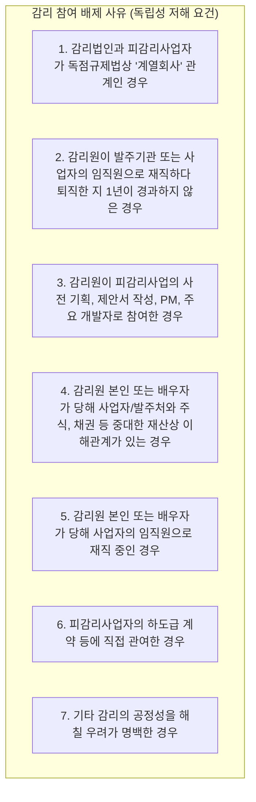

# 행정안전부 고시 「정보시스템 감리기준」 조문별 정밀 해설

본 문서는 행정안전부 고시인 **「정보시스템 감리기준」**의 전문과 해설서를 감리사 수험 목적에 맞춰 조문별로 완벽히 분해·해설한 자료입니다. 제1과목(감리 및 사업관리)의 고득점을 결정짓는 핵심 법정 규정입니다.

---

## 제1장 총칙

### [제1조 (목적) 및 제2조 (적용범위)]
*   **목적**: 「전자정부법」 제57조부터 제62조까지 및 같은 법 시행령 제71조부터 제78조까지의 규정에 따라 공공 정보시스템 감리의 절차, 방법 및 기준에 관한 세부사항을 규정함을 목적으로 함.
*   **적용 대상**: 중앙행정기관, 지방자치단체, 공공기관이 추진하는 모든 정보시스템 감리 용역에 전면 적용됨.

---

### [제3조 (용어의 정의)] - 매년 1문항 이상 100% 출제
1.  **감리발주자**: 감리를 발주하는 행정기관등의 장 (통상 발주처).
2.  **피감리인**: 감리 대상 사업을 수행하는 자 (구축 사업자, 주사업자 및 하도급자).
3.  **감리법인**: 전자정부법 제58조에 따라 행정안전부장관에게 등록을 필한 법인.
4.  **총괄감리원**: 당해 감리 업무 전체를 총괄·지휘하는 자로서, **반드시 감리법인에 상근(常勤)하는 수석감리원 중에서 지정**하여야 함. *(비상근 감리원은 절대 총괄감리원이 될 수 없음)*
5.  **수석감리원**: 감리사 자격을 취득한 자, 기술사 자격 보유자 등 법정 자격을 갖추고 수석감리원 교육을 이수한 자.
6.  **일반감리원**: 기사 자격 취득 후 일정 경력을 갖추고 감리원 기본교육을 이수한 자.
7.  **전문인력**: 데이터베이스, 정보보안, 클라우드, 네트워크 등 특정 특수 기술 분야의 자격을 갖추고 감리팀에 임시 투입되는 외부 전문가.

---

## 제2장 감리원의 자격 및 독립성

### [제4조 (감리원의 배치 및 참여)]
*   **상근 감리원 참여율**: 감리법인은 감리수행계획서 제출 시 투입 감리인원 중 **상근 감리원의 비율이 일정 기준(통상 총 공수의 70% 이상) 이상 유지**되도록 편성하여야 함.
*   감리원은 동시에 2개 이상의 현장감리에 중복 투입될 수 없음.

---

### [제5조 (감리 참여 배제 사유 - 독립성 침해 금지)] ★ 최고 빈출 킬러 조항!
감리원 및 감리법인은 다음 각 호의 어느 하나에 해당하는 경우 **해당 사업의 감리에 참여할 수 없음**:

> **[빈출 시험 함정 포인트]**
> - *함정 1*: "퇴직한 지 2년이 지난 감리원은 감리에 참여할 수 없다" $\rightarrow$ **오답! (1년이 경과하면 참여 가능)**
> - *함정 2*: "해당 감리법인이 피감리사업의 ISP(정보전략계획)를 수행한 경우, 본 구축사업 감리에 무조건 참여할 수 없다" $\rightarrow$ **오답! (ISP 수립은 감리 배제 사유에 해당하지 않음. 단, 본 사업의 상세 설계나 제안요청서 RFP 작성을 대행한 경우는 배제될 수 있음)**

---

## 제3장 감리 계약 및 계획 수립

### [제8조 (감리계획서의 작성 및 제출)]
*   감리법인은 감리계약 체결 후, 현장감리 착수일 전에 발주기관과 협의하여 **감리계획서**를 발주기관의 장 및 피감리인에게 제출해야 함.
*   **감리계획서 필수 기재사항 (암기 필수)**:
    1.  감리의 목적 및 범위
    2.  감리 일정 및 장소
    3.  감리원 편성 내역 및 담당 분야 (총괄감리원, 부문별 담당감리원, 전문인력 명시)
    4.  감리 점검 프레임워크 및 단계별 점검 기준
    5.  점검 항목 및 점검 방법 (문서 검토, 인터뷰, 도구 실사 등)
    6.  피감리인 협조 요청사항 및 사전 제출 산출물 목록

---

### [제9조 (기본 감리인원수 산정 공식)]
공공 SW 감리 발주 시 기준이 되는 감리 투입 공수(Man-Day: M/D) 산정 방식:

$$\mathbf{\text{총 감리인원수(M/D)} = \text{기본 감리인원수} \times \text{난이도 가중치}}$$

*   **난이도 보정 요소 5대 지표**:
    1.  **사업비 규모**: 사업비가 클수록 기준 M/D 증가.
    2.  **사업 기간**: 사업 기간이 장기일수록 중간 점검 소요 증가.
    3.  **개발 유형**: 신규 개발 vs 단순 재구축 vs 고도화 vs 패키지 도입.
    4.  **기술적 난이도**: 최신 신기술(클라우드 네이티브, AI, 마이크로서비스) 적용 여부.
    5.  **연계 복잡도 및 운영 환경**: 연계 대상 대외 기관 수 및 다중 사이트 운영 여부.

---

## 제4장 현장감리 수행 및 보고서 작성

### [제10조 (착수회의)]
*   현장감리 첫날 오전 실시.
*   감리 목적, 일정, 점검 방법, 감리원별 담당 업무를 설명하고, 피감리인으로부터 사업 현황 및 주요 이슈를 청취.

---

### [제11조 (현장감리 실시 및 실사)]
*   감리원은 독립적이고 객관적인 입장에서 문서 검토, 담당자 면담, 시스템 실사를 병행.
*   **실사 검증 필수 항목**:
    *   소스코드 정적 분석 도구를 통한 **소프트웨어 보안약점(49개) 진단**
    *   데이터베이스 ERD와 실제 DBMS 카탈로그 테이블 간의 정합성 검증
    *   인터페이스 연계 전문 송수신 테스트 및 암호화 적용 여부 실사

---

### [제12조 (종료회의)]
*   현장감리 마지막 날 실시.
*   감리수행결과 보고서 초안을 바탕으로 발주기관과 피감리인에게 감리 결과를 구두로 설명하고 의견을 청취.
*   **이견 처리 원칙**: 피감리인이 지적사항에 대해 이견을 제시하고 객관적 소명 자료를 제출하는 경우, 감리팀 내부 회의를 거쳐 보고서 내용을 합리적으로 조정함.

---

### [제13조 (감리수행결과보고서 작성 및 등급 판정)]
*   **감리 결과 등급 판정 (3단계 종합 판정)**:
    *   **적합**: 요구사항이 대부분 충족되고 중대한 결함이 없는 상태.
    *   **보통**: 일부 개선이 필요하나 프로젝트의 근간을 위협하지 않는 상태.
    *   **미흡**: 치명적인 보안 결함, 성능 미달, 요구사항 대량 미구현 등 차기 단계 진행이 불가능한 상태.
*   **개선권고사항 3단 논법**:
    1.  **현황 및 문제점**: 객관적 사실(Fact)과 근거 자료를 명시.
    2.  **개선방향**: 관련 표준 및 가이드라인에 기반한 해결 원칙 제시.
    3.  **세부조치방안**: 구체적이고 실행 가능한(Actionable) 기술적·관리적 해결 방법 제시.

---

### [제15조 (조치내역 확인)] ★ 시험 단골 출제!
1.  피감리인은 감리보고서를 통보받은 후, 지정된 기한 내에 지적사항을 시정 조치하고 **「시정조치 결과서」**를 발주기관에 제출.
2.  발주기관은 감리법인에 시정조치 완료 여부 확인을 의뢰.
3.  **총괄감리원 및 담당 감리원은 현장 실사 또는 서면 검토를 수행**.
4.  지적사항이 온전히 조치되었음을 확인한 후 **「시정조치 확인보고서」**를 작성하여 발주기관에 공식 제출.
5.  *미조치 시*: 조치가 미흡한 경우 추가 조치를 요구할 수 있으며, 최종 미이행 시 발주기관의 장에게 그 사유와 위험도를 공식 보고하여 검수 보류 등의 조치를 취하게 함.
