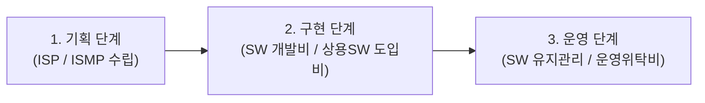

# SW사업 대가산정 가이드 (KOSA) 종합 마스터 가이드

본 문서는 한국소프트웨어산업협회(KOSA)에서 공표하는 **「SW사업 대가산정 가이드」**의 전 영역을 감리사 수험 목적에 맞춰 체계적으로 정리한 심화 지침서입니다. 제1과목(감리 및 사업관리)의 기능점수(FP) 계산문제 및 대가산정 규정 문제의 100% 출제 근거입니다.

---

## 1. SW사업 대가산정 체계 개요 (소프트웨어진흥법 제46조)

공공 및 민간 SW사업의 대가는 수명주기(Lifecycle)에 따라 다음과 같이 3대 단계로 구분됩니다.

| 사업 단계 | 대상 업무 | 대가 산정 방식 | 비고 |
| :--- | :--- | :--- | :--- |
| **1. 기획 단계** | 정보전략계획(ISP), 정보시스템마스터플랜(ISMP), 정보보안 컨설팅 | **투입공수(M/M) 방식** | 기획 단계는 기능 정의 전이므로 소프트웨어 기술자 노임단가 적용 |
| **2. 구현 단계** | 맞춤형 소프트웨어 신규 개발 및 재구축 | **기능점수(FP) 방식 (원칙)** | 특별한 사유가 없는 한 투입공수 방식 적용 금지 |
| | 기성 패키지 상용SW 구매 및 설치 | **상용SW 도입비 (물품 대가)** | 조달청 종합쇼핑몰 등록 가격 또는 견적 가격 기준 |
| **3. 운영 단계** | 개발된 시스템의 하자보수 이후 일상 유지관리 | **SW 개발비 대비 정률 요율 방식** | 개발비의 연간 10~15% 수준 (등급별 차등) |
| | 정보시스템 전산실 운영 및 헬프데스크 위탁 | **투입공수(M/M) 방식 또는 SLA 기반** | 상주 운영인력 등급별 인건비 |

---

## 2. 기능점수(FP: Function Point) 산정 절차 7단계

기능점수 방식은 사용자가 요구한 소프트웨어의 '논리적 기능 크기'를 정량적으로 측정하여 개발비를 산출하는 표준 기법입니다.

### [Step 1] 측정 유형 결정
*   **개발 프로젝트 기능점수 (Development FP)**: 시스템을 최초로 신규 구축할 때 설치 및 변환 기능까지 포함하여 측정.
*   **개선 프로젝트 기능점수 (Enhancement FP)**: 기존 시스템에 기능을 추가, 변경, 삭제할 때의 변경 규모 측정.
*   **애플리케이션 기능점수 (Application FP)**: 현재 운영 중인 시스템 자체의 정적 기능 크기 측정 (유지관리 대가 산정 기준).

### [Step 2] 측정 범위 및 애플리케이션 경계 설정
*   측정 대상이 되는 시스템의 경계(Boundary)를 명확히 획정하여, 내부 기능과 외부 연계 기능을 분리.

---

### [Step 3] 데이터 기능 점수 산정 (Data Functions)
데이터 기능은 시스템 내부에 저장되거나 외부와 연계되는 데이터 그룹(논리 파일)의 복잡도를 측정합니다.

1.  **ILF (Internal Logical File: 내부논리파일)**:
    *   대상 시스템 내부에서 유지(등록, 수정, 삭제)되는 논리적 데이터 그룹 (예: 회원 테이블, 주문 테이블).
2.  **EIF (External Interface File: 외부연계파일)**:
    *   타 시스템에서 유지관리되며 대상 시스템은 오직 참조(조회)만 해오는 데이터 그룹 (예: 도로명주소 API DB).

#### 정규법 복잡도 매트릭스 (RET & DET)
*   **RET (Record Element Type)**: 논리 파일 내의 서브타입 개수 (예: 결제 테이블에서 신용카드/계좌이체/무통장입금으로 구분 시 RET=3).
*   **DET (Data Element Type)**: 사용자가 식별 가능한 고유 필드(속성) 개수.

| 데이터 기능 구분 | 낮음 (Low) | 보통 (Average) | 높음 (High) |
| :--- | :---: | :---: | :---: |
| **ILF (내부논리파일)** | **7 FP** | **10 FP** | **15 FP** |
| **EIF (외부연계파일)** | **5 FP** | **7 FP** | **10 FP** |

#### 간이법 적용 가중치 (암기 필수!)
*   **ILF 평균 가중치 = 7.5 FP**
*   **EIF 평균 가중치 = 5.4 FP**

---

### [Step 4] 트랜잭션 기능 점수 산정 (Transaction Functions)
사용자가 데이터를 입력, 출력, 조회하는 처리 프로세스를 측정합니다.

1.  **EI (External Input: 외부입력)**:
    *   외부에서 데이터나 제어 신호가 들어와 내부 ILF를 변경(등록, 수정, 삭제)하는 기능.
2.  **EO (External Output: 외부출력)**:
    *   데이터를 외부로 전송/출력하되, **수학적 계산, 파생 데이터 생성, 통계 집계 등 가공 로직이 포함된 기능**.
3.  **EQ (External Inquiry: 외부조회)**:
    *   별도의 파생 계산이나 내부 ILF 변경 없이 **단순 검색하여 인출하는 기능**.

#### 정규법 복잡도 매트릭스 (FTR & DET)
*   **FTR (File Type Referenced)**: 트랜잭션이 참조하거나 갱신하는 ILF/EIF 파일의 개수.
*   **DET (Data Element Type)**: 화면의 입력 필드, 출력 필드, 클릭 버튼 등 사용자 식별 가능한 데이터 요소 수.

| 트랜잭션 구분 | 낮음 (Low) | 보통 (Average) | 높음 (High) |
| :--- | :---: | :---: | :---: |
| **EI (외부입력)** | **3 FP** | **4 FP** | **6 FP** |
| **EO (외부출력)** | **4 FP** | **5 FP** | **7 FP** |
| **EQ (외부조회)** | **3 FP** | **4 FP** | **6 FP** |

#### 간이법 적용 가중치 (암기 필수!)
*   **EI 평균 가중치 = 4.6 FP**
*   **EO 평균 가중치 = 5.2 FP**
*   **EQ 평균 가중치 = 3.9 FP**

---

### [Step 5] 미조정 기능점수 (UFP: Unadjusted Function Point) 산출

$$\mathbf{\text{UFP} = (\text{ILF 개수} \times 7.5) + (\text{EIF} \times 5.4) + (\text{EI} \times 4.6) + (\text{EO} \times 5.2) + (\text{EQ} \times 3.9)}$$

---

### [Step 6] 5대 보정계수 적용 및 최종 개발원가 산출

$$\mathbf{\text{SW 개발원가} = \text{UFP} \times \text{FP당 단가} \times (K_1 \times K_2 \times K_3 \times K_4 \times K_5)}$$

#### 5대 보정계수 세부 기준
1.  **규모 보정계수 ($K_1$)**:
    *   프로젝트의 규모(FP 크기)에 따른 생산성 곡선 반영 (소규모 및 초대규모 고정비 보정).
2.  **애플리케이션 연계 복잡도 보정계수 ($K_2$)**:
    *   연계 대상 대외 기관 및 내부 시스템 연계 수에 따라 **0.88 ~ 1.16** 차등 적용.
3.  **성능 요구수준 보정계수 ($K_3$)**:
    *   실시간 고속 응답이나 대량 트랜잭션 처리가 필요한 경우 가산 적용.
4.  **운영환경 다중사이트 보정계수 ($K_4$)**:
    *   단일 사이트 설치 vs 이기종 HW 및 다중 센터(원격지 분산) 설치 여부에 따라 가산.
5.  **보안성 수준 보정계수 ($K_5$)**:
    *   시큐어코딩 진단 및 최고 등급 보안(개인정보 암호화, 웹 취약점 전수 차단) 요구 시 가산.

---

### [Step 7] 총 SW 개발비 최종 합산

$$\mathbf{\text{총 SW 개발비} = \text{SW 개발원가} + \text{직접경비} + \text{이윤}}$$

*   **직접경비**: 사업 수행에 직접 소요되는 실비 (인쇄비, 여비교통비, 외부 전문가 자문료, SW 임차료, 회선비 등).
*   **이윤 (Profit)**:
    $$\mathbf{\text{이윤} = (\text{SW 개발원가} + \text{일반관리비}) \times \text{이윤율}}$$
    *   *법정 한도*: **SW 개발원가의 최대 25% 이내**로 제한됨.
