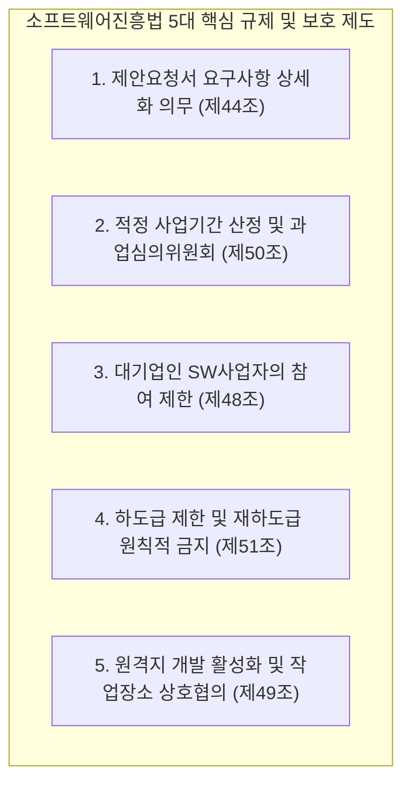
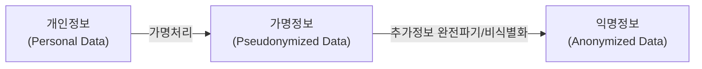

# 주요 법령 및 신기술 국가 가이드라인 종합 마스터 해설

본 문서는 공공 정보화 사업의 추진 및 감리 실무에서 반드시 준수해야 하는 **소프트웨어진흥법, 전자정부법, 개정 개인정보보호법**의 핵심 법률 조문과, 과학기술정보통신부/KISA의 **국가 제로트러스트 가이드라인 v2.0 및 생성형 AI 안전성 가이드라인**을 총망라한 종합 해설서입니다.

---

## 1. 소프트웨어진흥법 (공공 SW사업 5대 핵심 제도 정밀 분석)

공공 소프트웨어 시장의 공정경쟁 환경 조성 및 SW 가치 보장을 위해 소프트웨어진흥법에서 규정한 5대 강행 제도는 매년 감리사 시험의 단골 출제 영역입니다.

### [제1제도] 제안요청서 요구사항 상세화 의무 (제44조)
*   **원칙**: 국가기관등의 장은 SW사업을 발주할 때 제안요청서(RFP)에 과업의 내용과 요구사항을 **기능적·비기능적 수준까지 측정 가능하도록 명확하게 상세화**하여야 함.
*   **목적**: 발주처의 불명확한 요구로 인한 무상 과업 추가(Scope Creep) 및 사업 지연 방지.

---

### [제2제도] 과업심의위원회 설치 및 적정 사업기간 산정 (제50조) ★ 최고 빈출!
*   **과업심의위원회 의무 설치**: 공공 SW사업 발주기관은 사업 기획 단계부터 과업심의위원회를 반드시 설치·운영해야 함.
*   **주요 심의 사항**:
    1.  과업 내용의 확정 및 적정 사업기간 산정
    2.  사업 수행 중 과업 변경(추가, 축소) 및 이에 따른 **계약금액 및 계약기간의 조정**
*   **과업 변경 요청 시 처리 기한 (시험 빈출 숫자!)**:
    *   사업자가 서면으로 과업 변경 심의를 요청한 경우, 발주기관의 장은 특별한 사유가 없는 한 **14일 이내에 과업심의위원회를 개최**하여 그 결과를 사업자에게 서면 통보하여야 함.

---

### [제3제도] 대기업 참여 제한 제도 (제48조)
*   **원칙**: 중소 SW기업의 육성을 위해, 중소벤처기업부 고시 기준에 따라 **상호출자제한기업집단 소속 대기업은 모든 공공 SW사업에 원칙적으로 입찰 참여 불가**.
*   **예외적 대기업 참여 허용 사유**:
    1.  국방, 외교, 치안, 전력 등 국가 안보와 직결된 국가 주요 인프라 사업
    2.  인공지능, 빅데이터, 클라우드 등 신기술 적용 사업으로 과학기술정보통신부장관의 심의·승인을 받은 경우
    3.  민간 자본을 유치하여 추진하는 민간투자형 SW사업

---

### [제4제도] 하도급 제한 및 재하도급 원칙적 금지 (제51조) ★ 킬러 조항!
*   **하도급 비율 50% 제한**:
    *   주사업자(원도급자)는 수주한 SW사업 금액의 **50%를 초과하여 하도급할 수 없음** (즉, 사업비의 50% 이상은 주사업자가 직접 수행해야 함).
*   **단순 물품 구매 등의 예외**: 단순 상용SW 구매, 단순 HW 장비 구매 금액은 하도급 금액 산정 비율에서 제외.
*   **재하도급 원칙적 금지**:
    *   하도급을 받은 하도급 사업자는 다른 사업자에게 다시 재하도급(2차 하도급)을 줄 수 없음.
    *   **[재하도급 예외 승인 요건 (암기 필수)]**:
        1.  발주기관의 사전 서면 승인을 득할 것
        2.  하도급받은 전체 금액의 **50% 이내**일 것
        3.  오직 **1회에 한하여** 재하도급할 것

---

### [제5제도] 원격지 개발 및 작업 장소 상호 협의 (제49조)
*   발주기관이 일방적으로 발주처 내 상주를 강제하는 행위 금지.
*   보안 요건이 충족되는 경우 사업자가 제안한 원격 작업 장소를 상호 협의하여 결정함.

---

## 2. 개인정보보호법 (개정 2차 완벽 반영 심화 해설)

### (1) 개인정보 3단계 개념 체계 비교

| 구분 | 정의 | 개인정보보호법 적용 여부 | 주요 활용 범위 |
| :--- | :--- | :---: | :--- |
| **개인정보** | 살아있는 개인에 관한 정보로서 성명, 주민번호 등을 통해 특정 개인을 알아볼 수 있는 정보 | **전면 적용 (100%)** | 정보주체의 명시적 동의 기반 처리 |
| **가명정보** | 추가 정보의 사용·결합 없이는 특정 개인을 알아볼 수 없도록 조치(가명처리)한 정보 | **특례 조항 적용** (일부 안전조치 준수) | **통계작성, 과학적 연구, 공익적 기록보존 목적 시 동의 없이 처리 가능** |
| **익명정보** | 시간·비용·기술 등을 합리적으로 고려할 때 더 이상 다른 정보를 사용하여도 개인을 알아볼 수 없는 정보 | **적용 제외 (0%)** | 완전 자유로운 활용 (빅데이터 분석, 오픈데이터) |

---

### (2) 개정 법률 핵심 4대 신설 제도

1.  **전체 매출액 기준 과징금 부과 (법 제64조의2)**:
    *   기존 "위반행위 관련 매출액의 3%" $\rightarrow$ **"전체 매출액의 3% 이하"**로 상향.
    *   *비례성 원칙 감안*: 위반행위와 관련 없는 매출액임이 입증되는 경우 해당 금액을 전체 매출액에서 제외함 (단, 입증책임은 기업에 있음).
2.  **개인정보 전송요구권 (마이데이터의 전 산업 확산 - 법 제35조의2)**:
    *   정보주체는 자신의 개인정보를 본인 또는 지정된 개인정보관리전문기관으로 직접 전송해 줄 것을 요구할 수 있음.
3.  **자동화된 결정에 대한 권리 신설 (법 제37조의2)**:
    *   인공지능 등 완전히 자동화된 시스템이 내린 결정으로 인해 중대한 영향을 받는 경우, **거부권 행사 또는 설명 요구 가능**.
4.  **개인정보 유출 신고 및 통지 의무 (법 제34조)**:
    *   **1천 명 이상의 정보주체** 정보가 유출된 경우 **72시간 이내에 개인정보보호위원회 또는 KISA에 신고**하고 정보주체에게 개별 통지.

---

## 3. 국가 제로트러스트 가이드라인 v2.0

### (1) 제로 트러스트 3대 핵심 원칙
1.  **명시적 검증 (Verify Explicitly)**: 신뢰하는 내부망은 존재하지 않으며, 사용자 신원, 기기 상태, 접속 위치, 서비스 무결성 등 모든 컨텍스트를 매번 동적으로 인증.
2.  **최소 권한 부여 (Least Privilege Access)**: 역할 기반(RBAC) 및 속성 기반(ABAC) 동적 권한 관리를 통해 작업 수행에 필요한 최소한의 세션 단위 권한만 부여.
3.  **침해 가정 (Assume Breach)**: 공격자가 이미 내부 시스템에 침투해 활동 중임을 전제하고, 내부 네트워크 마이크로 세그멘테이션 및 전 구간 종단간 암호화 적용.

### (2) 제로 트러스트 6대 핵심 보안 요소
*   **식별자 (Identity)**: 강력한 다중 인증(MFA), FIDO, 지속적 적응형 위험 인증.
*   **기기 (Device)**: 엔드포인트 무결성 진단(EDR), OS 패치 상태, 탈옥/루팅 여부 실시간 검증.
*   **네트워크 (Network)**: 소프트웨어 정의 경계(SDP), 마이크로 세그멘테이션으로 수평 이동(Lateral Movement) 차단.
*   **시스템 (System)**: 가상화 컨테이너 보안, 클라우드 인프라 보안 태세 관리(CSPM).
*   **애플리케이션 (Application)**: API 게이트웨이 보안, WAF, 마이크로서비스 간 mTLS 상호 암호화.
*   **데이터 (Data)**: 전송 중/저장 중 전 구간 암호화, 데이터 접근 이력 실시간 로깅 및 감사.
