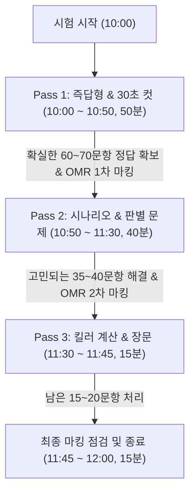

# 120분 타임어택 실전 풀이 및 시험장 운용 전략

정보시스템감리사 시험 불합격자의 80%는 "지식이 부족해서"가 아니라 **"시간이 모자라 15~25문제를 읽지도 못하고 찍어서"** 떨어집니다. 120분 동안 125문항을 정확히 풀고 마킹까지 완료하는 실전 타임어택 전략을 정리합니다.

---

## 1. 시간 배분의 현실 (Time Budget)

- **총 시험 시간**: 120분 (오전 10:00 ~ 12:00)
- **총 문항 수**: 125문항 (5과목 $\times$ 25문항)
- **시간 예산표**:
  - **OMR 마킹 및 최종 검토**: **15분** (11:45 ~ 12:00)
  - **순수 문제 풀이 가용 시간**: **105분** (1문항당 평균 **50.4초**)

> [!CAUTION]
> 지문이 10줄이 넘는 시나리오 문제나 복잡한 표/계산 문제는 읽는 데만 30~40초가 걸립니다. 한 문제에 1분 30초 이상 머무르는 순간, 시험 후반부의 '쉬운 10문제'를 날리게 됩니다.

---

## 2. 합격자들의 '3-Pass (3회독) 실전 풀이법'

시험지를 1번부터 125번까지 우직하게 순서대로 푸는 방식은 필패합니다. 시험지를 3번 훑어보는 '3-Pass 전략'을 체화해야 합니다.

### ① Pass 1: 즉답형 및 단답형 문제 전수 해결 (소요시간: 50분)
- 문제를 읽자마자 30초 내에 정답이 명확히 보이는 문제(개념 정의, 법령 조문, 단순 암기 지문)만 먼저 풉니다.
- **조치**: 지문이 길거나 복잡한 계산식, 헷갈리는 선지가 나오면 **1초의 망설임도 없이 문제 번호에 크게 별표(★)를 치고 즉시 다음 문제로 넘어갑니다**.
- 이 단계에서 약 60~70문항을 확실히 맞히며 심리적 안정감을 확보합니다.

### ② Pass 2: 독해 및 소거법 적용 문제 해결 (소요시간: 40분)
- 별표 친 문제들 중, 지문은 길지만 차분히 읽으면 맞힐 수 있는 시나리오 문제와 2개 선지 중 헷갈리는 문제를 풉니다.
- **소거법 적용**: 확실히 틀린 2개 선지를 먼저 지우고, 남은 2개 선지의 핵심 키워드를 비교하여 정답 도출.

### ③ Pass 3: 고난도 계산문제 및 킬러 문제 해결 (소요시간: 15분)
- 끝까지 남겨둔 복잡한 EVM/FP/서브넷 계산문제와 지극히 생소한 문제를 풉니다.
- 만약 시간이 5분밖에 남지 않았다면, 풀리지 않는 문제는 가장 출제 빈도가 적게 나온 번호로 기둥을 세워 마킹을 완료합니다.

---

## 3. 과목별 풀이 순서 전략

1번부터 5번 과목까지 순서대로 풀 필요가 없습니다. 뇌의 집중력이 가장 높은 초반에 전략 과목을 먼저 공략해야 합니다.

### 추천 풀이 순서
1. **1순위: 보안 (제5과목)**
   - 단답형 및 암기형 비중이 높아 초반 15~18분 내에 빠른 속도로 25문항 풀이가 가능하여 시간 버퍼를 확보하기 가장 좋습니다.
2. **2순위: 감리 및 사업관리 (제1과목)**
   - 법령과 고시 지문이 명확하여 정답 판단이 빠릅니다. (단, 계산문제는 Pass 3으로 넘김)
3. **3순위: 소프트웨어공학 (제2과목)**
   - 디자인패턴, 아키텍처, 테스트 기법 등 익숙한 실무 지식으로 안정적 점수 확보.
4. **4순위: 데이터베이스 (제3과목)**
   - 정규화, SQL 분석 등 지문 해석에 집중력이 요구되는 시점에 풀이.
5. **5순위: 시스템구조 (제4과목 - 가장 마지막에 풀이)**
   - 가장 생소하고 계산/회로/파이프라인 등 시간 소모가 큰 과목이므로, 앞선 4과목의 점수를 먼저 안전하게 챙겨둔 뒤 차분히 방어(과락 방지) 모드로 풉니다.

---

## 4. OMR 카드 마킹 및 시험장 팁

### ① 과목별 분할 마킹 원칙 (125문항 일괄 마킹 금지!)
- 마지막 10분에 125문항을 한 번에 마킹하려 하면 손이 떨리고, 밀려 쓰기 실수가 발생할 확률이 매우 높습니다.
- **과목 1개를 완주할 때마다(또는 Pass 1이 끝난 시점) 해당 문항들을 OMR에 옮겨 적는 분할 마킹**이 가장 안전합니다.

### ② 시험 당일 필수 지참물 체크리스트
- [ ] **신분증 (주민등록증, 운전면허증, 여권 등)** - 미지참 시 응시 불가
- [ ] **수험표 출력본**
- [ ] **컴퓨터용 수성 싸인펜 (2자루 이상)** - 촉이 굵은 것 준비
- [ ] **수정테이프 (화이트)** - 마킹 수정 시 필수 (스티커형 사용 금지)
- [ ] **아날로그 손목시계** - 스마트워치 및 전자식 시계는 시험장 반입 금지
- [ ] **초콜릿 또는 포도당 캔디** - 120분 연속 고도의 뇌 사용에 따른 당 보충용
